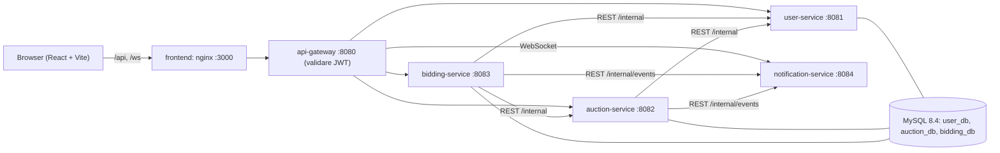

# Live Auction App

Platformă de licitații live cu **monede virtuale**, realizată la disciplina **Proiect de Software pentru Telecomunicații**: Universitatea Transilvania din Brașov, Facultatea de Inginerie Electrică și Știința Calculatoarelor, anul universitar 2026–2027. Coordonatorul proiectului este Ș.L. Dr. Ing. Horia Modran. Echipa are 5 membri și lucrează după metodologia Agile/Scrum.

## Ce face aplicația

- **Cont și portofel:** înregistrare și autentificare cu JWT. Portofelul primește 1000 de monede bonus la înregistrare și poate fi alimentat demo.
- **Creare licitație:** titlu, descriere, până la 5 fotografii, preț de pornire, increment minim, dată de început și de sfârșit.
- **Listare:** licitații programate, active și încheiate, cu paginare.
- **Licitare live:** prețul, istoricul ofertelor și cronometrul se actualizează instantaneu pentru toți cei care urmăresc licitația (WebSocket/STOMP).
- **Rezervarea fondurilor:** banii se **rezervă** când licitezi și se **eliberează** când ești depășit. Primești o notificare „Ai fost depășit”.
- **Anti-sniping:** o ofertă plasată în ultimele 30 de secunde prelungește licitația cu 30 de secunde.
- **Închidere automată:** câștigătorul plătește, iar vânzătorul încasează.

## Arhitectură



Detalii complete, diagrame UML și fluxurile principale: [docs/architecture.md](docs/architecture.md).

## Pornire rapidă

Ai nevoie de Docker Desktop (cu WSL2 pe Windows) și Git. Pentru dezvoltare mai ai nevoie de JDK 21, Node 24 LTS și IntelliJ IDEA.

```bash
git clone https://github.com/seba-dvd/live-auction-app.git
cd live-auction-app
cp .env.example .env
docker compose up -d --build
```

- Aplicația: <http://localhost:3000>
- Starea gateway-ului: <http://localhost:8080/actuator/health>
- Oprire, cu păstrarea datelor: `docker compose down`
- Ștergerea completă a bazei de date: `docker compose down -v`

Pentru a lucra la un singur serviciu: pornești restul cu Compose și rulezi serviciul tău din IntelliJ. Pașii exacți sunt în ghidul tău din [docs/team/](docs/team/README.md).

## Porturi

| Componentă | Port | Publicat de | Swagger UI (doar dev) |
|---|---|---|---|
| frontend (nginx) | 3000 | `docker-compose.yml` | — |
| frontend (Vite dev) | 5173 | `npm run dev` | — |
| api-gateway | 8080 | `docker-compose.yml` | — |
| user-service | 8081 | `docker-compose.override.yml` | <http://localhost:8081/swagger-ui.html> |
| auction-service | 8082 | `docker-compose.override.yml` | <http://localhost:8082/swagger-ui.html> |
| bidding-service | 8083 | `docker-compose.override.yml` | <http://localhost:8083/swagger-ui.html> |
| notification-service | 8084 | `docker-compose.override.yml` | <http://localhost:8084/swagger-ui.html> |
| MySQL 8.4 | 3306 | `docker-compose.override.yml` | — |

`docker-compose.override.yml` se încarcă automat în dezvoltare. În producție se folosește `docker-compose.prod.yml`, care publică doar front-end-ul.

## Documentație

| Document | Conținut |
|---|---|
| [docs/architecture.md](docs/architecture.md) | Componente, securitate, proprietatea datelor, fluxuri, timp real |
| [docs/api-contracts.md](docs/api-contracts.md) | **Sursa unică de adevăr** pentru endpoint-uri, payload-uri și evenimente |
| [docs/database/README.md](docs/database/README.md) | Structura bazei de date, diagrame ER, justificarea „database-per-service” |
| [docs/decisions/](docs/decisions/README.md) | Decizii de arhitectură (ADR) |
| [docs/uml/](docs/uml/README.md) | Diagrame UML (surse PlantUML); imaginile sunt în [docs/diagrams/png/](docs/diagrams/png/) |
| [docs/product/backlog.md](docs/product/backlog.md) | User stories cu criterii de acceptanță și prioritate MoSCoW |
| [docs/project-charter/](docs/project-charter/README.md) | Carta proiectului (Word + PDF) |
| [docs/raport-tehnic/](docs/raport-tehnic/README.md) | Raport Tehnic: Proiectare (termen 30.11.2026), Word + PDF |
| [docs/team/README.md](docs/team/README.md) | Organizarea echipei, calendarul sprinturilor, riscuri, depanare |
| [CONTRIBUTING.md](CONTRIBUTING.md) | Fluxul Git, ramuri, PR-uri, rezolvarea conflictelor |
| [CLAUDE.md](CLAUDE.md) | Instrucțiuni pentru asistenții AI (identic cu [AGENTS.md](AGENTS.md)) |
| [postman/](postman/live-auction.postman_collection.json) | Colecția Postman și mediul `local` |
| [tools/ws-test.html](tools/ws-test.html) | Pagină de test pentru WebSocket/STOMP |

## Echipa

| ID | Membru | Rol în curs | Responsabil de | Ramură | Ghid |
|---|---|---|---|---|---|
| D | Pilat David Sebastian | Project Manager | `user-service`, `api-gateway` | `d/user-gateway` | [docs/team/D.md](docs/team/D.md) |
| M | Mituleci Tudor | Technical Lead | `bidding-service`, contracte API, arhitectură | `m/bidding` | [docs/team/M.md](docs/team/M.md) |
| K | Kubanda Andrei | Scrum Master | `auction-service`, baza de date | `k/auction` | [docs/team/K.md](docs/team/K.md) |
| A | Nicolescu Andreas | Product Owner | `frontend`, backlog, diagrama use case | `a/frontend` | [docs/team/A.md](docs/team/A.md) |
| R | Luncasu Razvan | DevOps Engineer | `notification-service`, Docker/CI/CD/Cloud, Postman | `r/devops` | [docs/team/R.md](docs/team/R.md) |

**Primul pas pentru fiecare membru:** citește ghidul tău din `docs/team/<ID>.md` (are și o versiune Word în `docs/team/docx/`).
