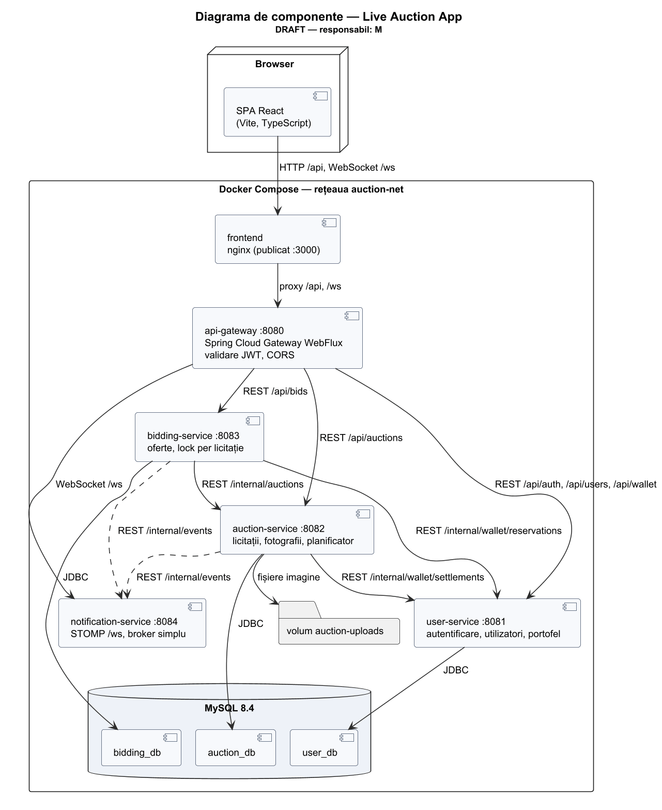
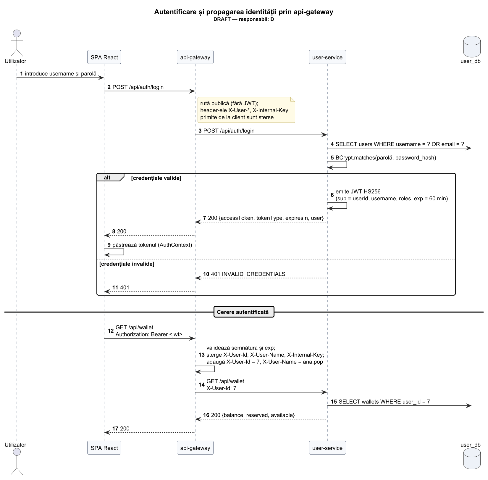
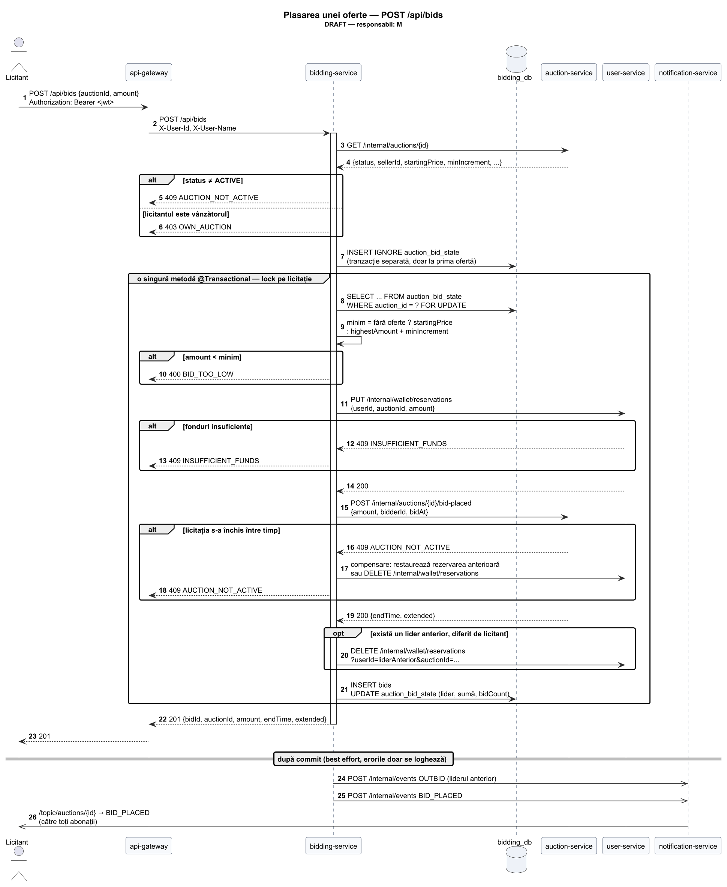
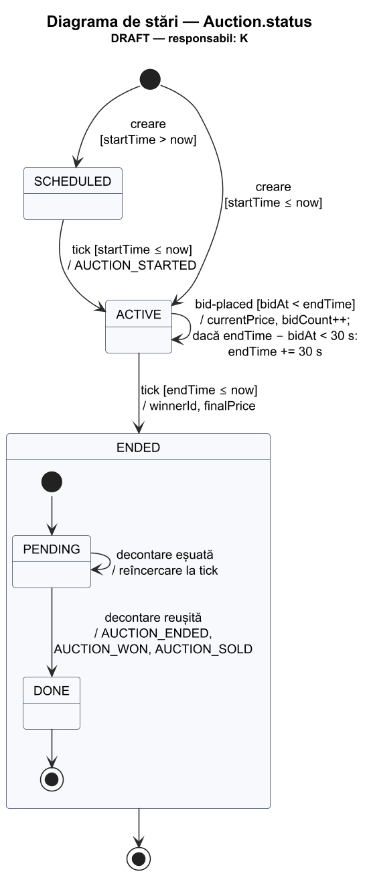
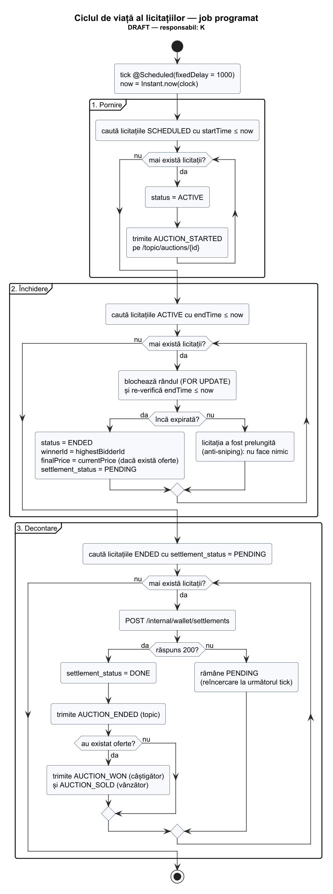
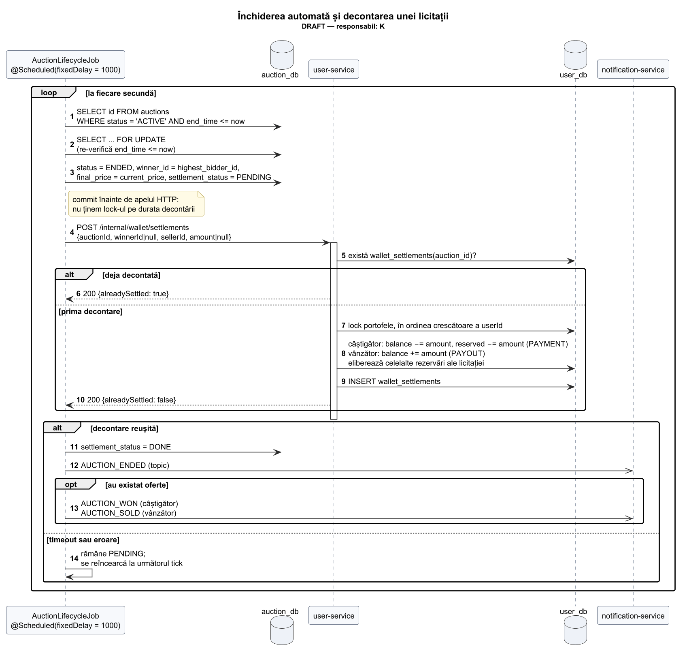
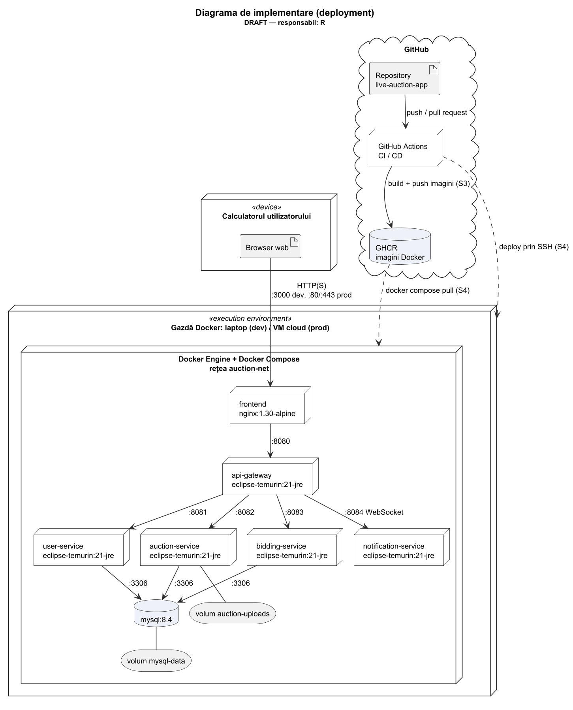

# Arhitectura sistemului

Responsabil: **M** (Technical Lead). Ultima actualizare: 27.10.2026 (v1, bootstrap).
Detaliile endpoint-urilor sunt în [api-contracts.md](api-contracts.md). Structura bazei de date este în [database/README.md](database/README.md). Deciziile de arhitectură sunt în [decisions/](decisions/README.md).

## 1. Scop și context

**Live Auction App** este o platformă de licitații în timp real cu monede virtuale:

- Utilizatorii primesc 1000 de monede la înregistrare.
- Fiecare utilizator poate crea licitații și poate licita la licitațiile altora.
- Toți cei care urmăresc o licitație văd instantaneu prețul, istoricul și cronometrul.
- Banii se rezervă la licitare, se eliberează când ești depășit și se decontează automat la final (câștigătorul plătește, vânzătorul încasează).

**Cerințele obligatorii ale cursului:**
- cel puțin 2 microservicii Spring Boot, cu comunicare REST între ele;
- bază de date SQL;
- Docker și Docker Compose;
- implementare în cloud;
- testare cu Postman și front-end;
- diagrame UML de clase și use case.

Arhitectura de mai jos le acoperă pe toate.

## 2. Vedere de ansamblu

| Componentă | Port | Responsabilitate | Date | Responsabil |
|---|---|---|---|---|
| frontend (React + nginx) | 3000 (5173 dev) | interfața web, conexiunea STOMP, cronometre | — | A |
| api-gateway | 8080 | punct unic de intrare: rutare, validare JWT, propagarea identității, CORS, proxy WebSocket | — | D |
| user-service | 8081 | conturi, autentificare (emitere JWT), portofel, rezervări, decontări | `user_db` | D |
| auction-service | 8082 | licitații, fotografii, ciclul de viață (planificator), anti-sniping | `auction_db` | K |
| bidding-service | 8083 | plasarea ofertelor (lock per licitație), istoricul ofertelor | `bidding_db` | M |
| notification-service | 8084 | STOMP peste WebSocket: topic public per licitație, coadă privată per utilizator | — (în memorie) | R |
| MySQL 8.4 | 3306 | o instanță, trei scheme, un utilizator per serviciu | — | K (design), R (operare) |

## 3. Comunicare

| Tip | De la → la | Mecanism | Exemple |
|---|---|---|---|
| Public sincron | browser → gateway → serviciu | REST/JSON prin HTTP | `POST /api/bids`, `GET /api/auctions` |
| Intern sincron | serviciu → serviciu | REST/JSON pe rețeaua Docker, `X-Internal-Key` | `PUT /internal/wallet/reservations` |
| Notificări | auction/bidding → notification | REST `POST /internal/events` (best effort, după commit) | `BID_PLACED`, `OUTBID` |
| Push către browser | notification → browser | STOMP peste WebSocket (prin gateway) | `/topic/auctions/42` |

**Apelurile interne folosesc `RestClient`** sau interfețe `@HttpExchange`:
- **Timeouts:** connect 2 s, read 5 s.
- **Stub-uri:** fiecare client are o implementare în memorie activată cu profilul `stub`, ca fiecare membru să poată lucra înainte ca serviciul de care depinde să fie gata ([ADR-003](decisions/ADR-003-rest-clients-stub-profile.md)).

| Apelant | Apelat | Endpoint | Când |
|---|---|---|---|
| bidding | auction | `GET /internal/auctions/{id}` | validarea ofertei |
| bidding | user | `PUT` / `DELETE /internal/wallet/reservations` | rezervare, eliberare, compensare |
| bidding | auction | `POST /internal/auctions/{id}/bid-placed` | actualizare preț + anti-sniping |
| bidding | notification | `POST /internal/events` | `BID_PLACED`, `OUTBID` |
| auction | user | `POST /internal/wallet/settlements` | decontarea la închidere |
| auction | notification | `POST /internal/events` | `AUCTION_STARTED`, `AUCTION_ENDED`, `AUCTION_WON`, `AUCTION_SOLD` |

## 4. Modelul de securitate

1. **Emiterea tokenului:**
   - user-service verifică parola cu BCrypt și emite un JWT HS256 cu `sub` = userId, `username`, `roles` și `exp` = 60 de minute.
   - Secretul `JWT_SECRET` (≥ 32 de octeți) e partajat cu gateway-ul și cu notification-service.
2. **Validarea la gateway:**
   - api-gateway validează JWT-ul pentru tot traficul HTTP.
   - Șterge header-ele `X-User-Id`, `X-User-Name` și `X-Internal-Key` trimise de client, apoi adaugă `X-User-Id` / `X-User-Name` din token.
   - Serviciile din spate au încredere în aceste header-e și nu parsează JWT-uri ([ADR-002](decisions/ADR-002-gateway-auth-internal-key.md)).
3. **Rute publice:** autentificare, citirea licitațiilor și a istoricului de oferte, `/ws`, `/actuator/health`. Lista exactă este în [api-contracts.md §2.3](api-contracts.md#23-rute-publice-fără-jwt).
4. **API intern:**
   - `/internal/**` nu are rută în gateway, așa că primește 404 din exterior.
   - Serviciile verifică header-ul `X-Internal-Key`.
   - În producție, porturile 8081–8084 nu se publică (`docker-compose.prod.yml`).
5. **WebSocket:**
   - notification-service validează JWT-ul trimis în cadrul STOMP `CONNECT`.
   - Numele `Principal` devine userId, iar cozile private `/user/queue/notifications` sunt disponibile doar conexiunilor autentificate.
   - Conexiunile anonime se pot abona doar la topicurile publice.
6. **Alte măsuri:**
   - Parolele se salvează doar ca hash BCrypt.
   - Fotografiile primesc nume UUID, iar tipul și dimensiunea lor se verifică.
   - CORS se configurează doar în gateway.
   - Secretele vin din variabile de mediu: `.env`, care nu se comite.

## 5. Proprietatea datelor

Fiecare serviciu are **schema lui** și **utilizatorul lui MySQL**, cu drepturi doar pe propria schemă ([ADR-004](decisions/ADR-004-database-per-service.md)).

| Date | Proprietar | Ceilalți le obțin prin |
|---|---|---|
| utilizatori, portofele, rezervări, tranzacții, decontări | user-service | `/api/users/*`, `/internal/wallet/*` |
| obiecte, fotografii, licitații (preț curent, lider, stare, sfârșit) | auction-service | `/api/auctions/*`, `/internal/auctions/*` |
| oferte, starea de licitare per licitație | bidding-service | `/api/bids/*`, `/internal/bids/*` |
| conexiuni și abonări WebSocket | notification-service (memorie) | — |

**Reguli:**
- **Fără chei străine între scheme.** Identificatorii altor servicii sunt coloane `BIGINT` simple (referințe logice).
- **Denormalizare controlată.** De exemplu, `bids.bidder_username` permite afișarea istoricului fără un apel la user-service.
- **Consistența între servicii** e asigurată de fluxurile din §6:
  - lock pe licitație;
  - operații idempotente (rezervări, decontări);
  - reîncercări (decontările `PENDING`).

## 6. Fluxuri principale

### 6.1 Plasarea unei oferte

Totul se întâmplă în bidding-service, într-o singură metodă `@Transactional`:

1. **Verificarea licitației.** `GET /internal/auctions/{id}`: 409 `AUCTION_NOT_ACTIVE` dacă licitația nu e activă, 403 `OWN_AUCTION` dacă licitantul este vânzătorul.
2. **Lock-ul și suma minimă.**
   - Se blochează rândul `auction_bid_state` cu `SELECT … FOR UPDATE` (`@Lock(PESSIMISTIC_WRITE)`).
   - Rândul se creează idempotent la prima ofertă (`INSERT IGNORE`, într-o tranzacție separată, înaintea lock-ului).
   - Suma minimă este `startingPrice` dacă nu există oferte, altfel `highestAmount + minIncrement`. Sub ea: 400 `BID_TOO_LOW`.
3. **Rezervarea fondurilor.** `PUT /internal/wallet/reservations` pentru licitant. Un 409 `INSUFFICIENT_FUNDS` se propagă.
4. **Actualizarea licitației.**
   - `POST /internal/auctions/{id}/bid-placed` actualizează licitația și aplică anti-sniping.
   - La 409 urmează compensarea: rezervarea anterioară se restaurează (dacă licitantul era deja lider) sau se șterge. Apoi răspunsul este 409.
5. **Eliberarea fostului lider.** Dacă a existat un lider anterior diferit de licitant, se cheamă `DELETE` pe rezervarea lui. La eșec doar se loghează: decontarea o eliberează oricum.
6. **Salvarea ofertei.** Se inserează rândul în `bids`, se actualizează starea (lider, sumă, număr de oferte) și se face commit.
7. **Notificări, după commit** (best effort, erorile doar se loghează): `OUTBID` către liderul anterior și `BID_PLACED` pe topicul licitației.

> **Regula de prezentat:** tot ce mișcă bani se întâmplă **cât timp ținem lock-ul licitației**. După commit se trimit doar notificările.

**Alternative și limitări:**
- **Optimistic locking:** varianta cu `@Version` și reîncercare este analizată în [ADR-001](decisions/ADR-001-bid-concurrency.md).
- **Limitare cunoscută:** dacă commit-ul eșuează după pasul 5, starea dintre servicii devine inconsistentă. Soluția completă este un saga sau un transactional outbox (evoluție viitoare). Riscul e mic, pentru că pașii 3–5 sunt idempotenți și decontarea finală reconciliază rezervările.

### 6.2 Ciclul de viață și închiderea automată

În auction-service rulează `AuctionLifecycleJob`, cu `@Scheduled(fixedDelay = 1000)` și `Clock` injectat:

- **Pornire.** `SCHEDULED → ACTIVE` când `startTime ≤ now`, apoi evenimentul `AUCTION_STARTED`.
- **Închidere.** `ACTIVE → ENDED` când `endTime ≤ now`:
  1. lock pe rând și re-verificare (anti-sniping poate fi mutat `endTime`);
  2. `status = ENDED`, `winnerId` și `finalPrice` din `highestBidderId` / `currentPrice`, `settlement_status = PENDING`;
  3. commit.
- **Decontare.** `POST /internal/wallet/settlements`:
  - la succes: `settlement_status = DONE`, apoi `AUCTION_ENDED` (topic), plus `AUCTION_WON` (câștigător) și `AUCTION_SOLD` (vânzător);
  - la eșec: rămâne `PENDING` și se reîncearcă la fiecare tick (decontarea e idempotentă per `auctionId`).

**Anti-sniping.** La `bid-placed`, dacă `endTime − bidAt < 30 s`, atunci `endTime += 30 s` și `extensionCount++`. Ofertele cu `bidAt ≥ endTime` sunt respinse (409).

## 7. Timp real

- **Endpoint:** STOMP peste WebSocket simplu, la `/ws`. Front-end-ul se conectează relativ, la `ws(s)://<host>/ws`, iar nginx sau Vite fac proxy către gateway, care face proxy către notification-service.
- **Broker:** simple broker în memorie. Topicul public `/topic/auctions/{id}`; coada privată `/user/queue/notifications`, cu `convertAndSendToUser(userId, …)`.
- **Mesaje:** anvelopa `{type, auctionId, serverTime, data}` și cele 6 tipuri de evenimente sunt descrise în [api-contracts.md §9](api-contracts.md#9-websocket--stomp-și-evenimente).
- **Cronometru:** front-end-ul calculează `offset = serverTime − ceasClient` la fiecare mesaj și la `GET /api/auctions/{id}`, apoi afișează `endTime − (ceasClient + offset)`. Nu folosește ceasul brut al clientului, care poate fi decalat cu minute.
- **Reconectare:** la reconectare, front-end-ul reîncarcă detaliile și istoricul prin REST, ca să nu piardă evenimente.

## 8. Implementare și operare

- **Local:**
  - `docker compose up -d --build`: MySQL + 5 servicii + front-end, cu healthcheck-uri și limită de 512 MB per serviciu Java.
  - `docker-compose.override.yml` publică portul MySQL și porturile serviciilor pentru dezvoltare.
- **CI:** GitHub Actions construiește și testează doar componentele modificate. PR-urile spre `main` construiesc tot.
- **CD și cloud (R, S3–S4):**
  - imaginile se publică în GHCR la push pe `main`;
  - o mașină virtuală rulează `docker compose -f docker-compose.yml -f docker-compose.prod.yml up -d`;
  - deploy-ul se face prin SSH din GitHub Actions;
  - sunt deschise doar porturile 80, 443 și 22;
  - alegerea furnizorului de cloud se documentează în ADR-005.

## 9. Decizii și alternative

| Decizie | Alternativă respinsă | Motiv |
|---|---|---|
| Lock pesimist per licitație ([ADR-001](decisions/ADR-001-bid-concurrency.md)) | `@Version` + reîncercare | ordine strictă a ofertelor, simplu de explicat și de testat |
| Autentificare la gateway + cheie internă ([ADR-002](decisions/ADR-002-gateway-auth-internal-key.md)) | fiecare serviciu validează JWT-ul | un singur loc pentru securitate, servicii mai simple |
| RestClient + profil `stub` ([ADR-003](decisions/ADR-003-rest-clients-stub-profile.md)) | Feign / WebClient | parte din Spring Framework 7, fără dependențe în plus |
| Database-per-service pe o instanță ([ADR-004](decisions/ADR-004-database-per-service.md)) | o singură schemă comună | izolare reală între servicii, cost mic |
| Docker DNS + variabile de mediu | Config Server, Service Registry (Eureka) | 5 servicii fixe într-o singură rețea Compose; complexitate nejustificată la această scară |
| Notificări prin REST către notification-service | broker de mesaje (RabbitMQ / Kafka) | mai puține componente de operat; RabbitMQ rămâne opțiune pentru S4 (M) |
| Controllere REST cu DTO-uri | Spring Data REST | contracte stabile, validare și coduri de eroare controlate |

## 10. Limitări cunoscute și evoluții

- **Consistența între servicii:**
  - e asigurată prin lock, idempotență și reîncercări;
  - nu există tranzacții distribuite;
  - un eșec de commit după apelurile externe poate lăsa rezervări „orfane” până la decontare;
  - evoluție: transactional outbox sau saga.
- **Notificările sunt best effort.** Un eveniment pierdut se recuperează prin REST la reîncărcare. Evoluție: RabbitMQ (STOMP broker relay) pentru livrare sigură și mai multe instanțe de notification-service.
- **Instanțe unice:**
  - simple broker-ul și jobul programat presupun câte o singură instanță per serviciu;
  - scalarea orizontală ar cere un broker extern și un lock distribuit pentru job (de exemplu ShedLock).
- **Reziliență:** fără circuit breaker (evoluție: Resilience4j) și fără service discovery (Docker DNS e suficient).
- **Securitate:**
  - JWT HS256 cu secret partajat, fără revocare (logout = ștergerea tokenului din client);
  - evoluție: RS256 + JWKS, refresh tokens.
- **Stocare:** fotografiile stau pe un volum Docker local (evoluție: stocare obiect, de tip S3/Blob).
