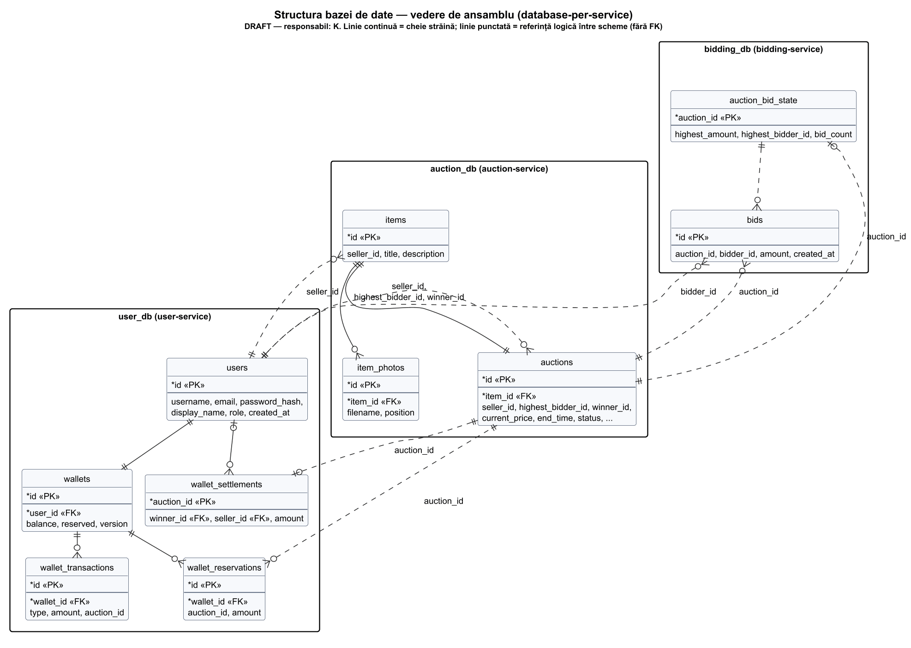
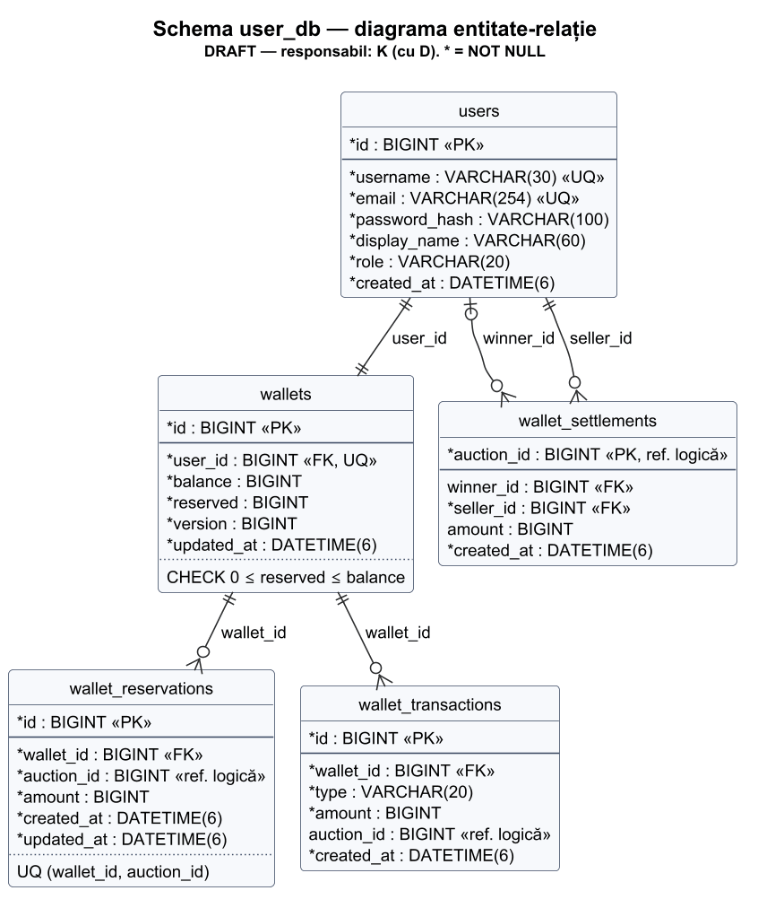
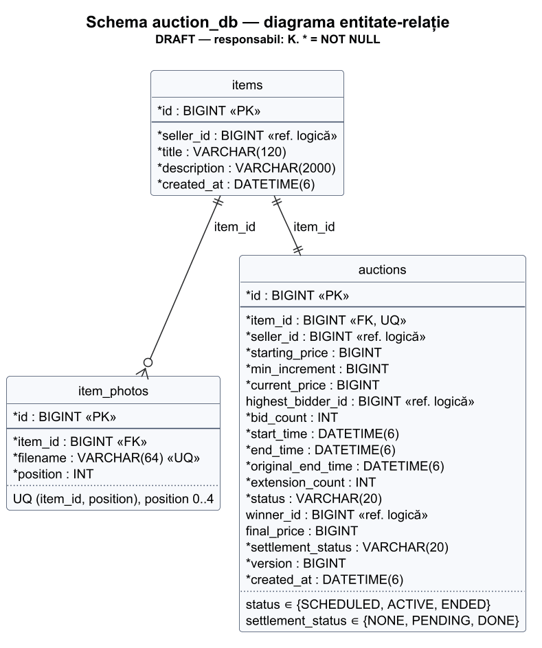
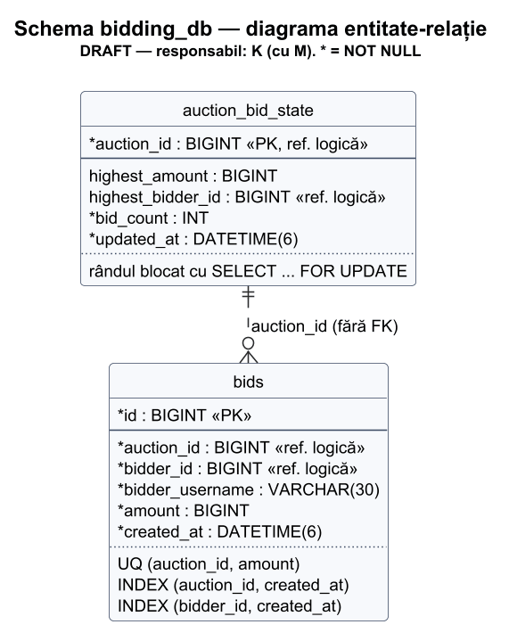

# Structura bazei de date

Responsabil: **K** (design final, verificarea tuturor migrațiilor). Fiecare proprietar de serviciu își scrie propriile migrații.
Sursa de adevăr pentru tabele sunt fișierele `V1__init.sql` din fiecare serviciu. Documentul de față le explică.

| Schemă | Serviciu | Utilizator MySQL | Migrații |
|---|---|---|---|
| `user_db` | user-service | `user_service` | [user-service/…/V1__init.sql](../../user-service/src/main/resources/db/migration/V1__init.sql) |
| `auction_db` | auction-service | `auction_service` | [auction-service/…/V1__init.sql](../../auction-service/src/main/resources/db/migration/V1__init.sql) |
| `bidding_db` | bidding-service | `bidding_service` | [bidding-service/…/V1__init.sql](../../bidding-service/src/main/resources/db/migration/V1__init.sql) |

## 1. De ce „database-per-service” pe o singură instanță MySQL

- **Izolare:**
  - fiecare serviciu are schema lui și un utilizator MySQL cu drepturi **doar** pe acea schemă (`db/init/01-init.sh`);
  - un serviciu nu poate citi sau strica datele altuia, ci le cere prin API;
  - asta este regula de bază a microserviciilor.
- **Cost mic:** o singură instanță MySQL 8.4, adică un container, un volum și un singur backup. Pentru un proiect de 5 persoane, trei instanțe separate ar consuma inutil RAM (fiecare ~400 MB).
- **Fără chei străine între scheme:**
  - identificatorii altor servicii (`auction_id`, `seller_id`, `bidder_id` etc.) sunt coloane `BIGINT` simple, adică **referințe logice**;
  - consistența lor e responsabilitatea fluxurilor de business: validare prin API, lock, idempotență.

Decizia completă este în [ADR-004](../decisions/ADR-004-database-per-service.md).

## 2. Convenții

- **Motor:** InnoDB, set de caractere `utf8mb4`, colaționare `utf8mb4_0900_ai_ci`.
- **Chei primare:** `BIGINT AUTO_INCREMENT`, cu excepția `wallet_settlements` și `auction_bid_state`, unde cheia este `auction_id`.
- **Momente de timp:** `DATETIME(6)` în **UTC**. În Java sunt `Instant`, cu `hibernate.jdbc.time_zone=UTC` și `hibernate.type.preferred_instant_jdbc_type=TIMESTAMP`.
- **Monede:** `BIGINT`, fără zecimale.
- **Enumerații:** `VARCHAR(20)` + `CHECK` (în Java: `@Enumerated(EnumType.STRING)`).
- **Nume:** `snake_case` în baza de date, `camelCase` în Java (`@Column(name = "...")`).
- **Constrângeri cu nume explicite:** `pk_`, `fk_`, `uq_`, `ck_`, `ix_`.
- **Migrații:** Flyway, cu `ddl-auto: validate`. Hibernate doar verifică schema, nu o modifică.
  - `V1__init.sql` se poate edita până la **30.11.2026**.
  - După această dată se adaugă doar fișiere noi `V2__...sql`, `V3__...sql`.
  - Altfel apare eroarea Flyway „checksum mismatch” pe calculatoarele colegilor; rezolvarea este `docker compose down -v`.

## 3. `user_db` (user-service, D)

| Tabel | Coloană | Tip | Null | Cheie / constrângere | Descriere |
|---|---|---|---|---|---|
| `users` | `id` | BIGINT | nu | PK, auto | identificatorul utilizatorului (`sub` din JWT) |
| | `username` | VARCHAR(30) | nu | UQ | `^[a-zA-Z0-9_.-]{3,30}$` |
| | `email` | VARCHAR(254) | nu | UQ | |
| | `password_hash` | VARCHAR(100) | nu | | hash BCrypt (60 de caractere) |
| | `display_name` | VARCHAR(60) | nu | | |
| | `role` | VARCHAR(20) | nu | CHECK (`USER`, `ADMIN`) | implicit `USER` |
| | `created_at` | DATETIME(6) | nu | | |
| `wallets` | `id` | BIGINT | nu | PK | |
| | `user_id` | BIGINT | nu | FK → `users.id`, UQ | relație 1:1 |
| | `balance` | BIGINT | nu | CHECK `0 ≤ reserved ≤ balance` | sold total |
| | `reserved` | BIGINT | nu | | suma rezervată pentru licitațiile active |
| | `version` | BIGINT | nu | | `@Version` (optimistic locking, plasă de siguranță) |
| | `updated_at` | DATETIME(6) | nu | | |
| `wallet_reservations` | `id` | BIGINT | nu | PK | |
| | `wallet_id` | BIGINT | nu | FK → `wallets.id` | |
| | `auction_id` | BIGINT | nu | referință logică, index | o rezervare per (portofel, licitație) |
| | `amount` | BIGINT | nu | CHECK > 0 | suma rezervată = ultima ofertă a utilizatorului |
| | `created_at`, `updated_at` | DATETIME(6) | nu | UQ (`wallet_id`, `auction_id`) | |
| `wallet_transactions` | `id` | BIGINT | nu | PK | |
| | `wallet_id` | BIGINT | nu | FK → `wallets.id`; index (`wallet_id`, `created_at`) | |
| | `type` | VARCHAR(20) | nu | CHECK (`SIGNUP_BONUS`, `TOP_UP`, `PAYMENT`, `PAYOUT`) | |
| | `amount` | BIGINT | nu | CHECK > 0 | mereu pozitiv; tipul dă sensul |
| | `auction_id` | BIGINT | da | referință logică | doar pentru `PAYMENT` / `PAYOUT` |
| | `created_at` | DATETIME(6) | nu | | |
| `wallet_settlements` | `auction_id` | BIGINT | nu | PK, referință logică | **idempotența decontării** |
| | `winner_id` | BIGINT | da | FK → `users.id` | `NULL` = fără oferte |
| | `seller_id` | BIGINT | nu | FK → `users.id` | |
| | `amount` | BIGINT | da | | |
| | `created_at` | DATETIME(6) | nu | | |

**Relații:**
- `users` 1 — 1 `wallets`
- `wallets` 1 — 0..* `wallet_reservations`
- `wallets` 1 — 0..* `wallet_transactions`
- `users` 1 — 0..* `wallet_settlements`, de două ori: o dată ca vânzător și o dată, opțional, ca și câștigător

## 4. `auction_db` (auction-service, K)

| Tabel | Coloană | Tip | Null | Cheie / constrângere | Descriere |
|---|---|---|---|---|---|
| `items` | `id` | BIGINT | nu | PK | obiectul licitat |
| | `seller_id` | BIGINT | nu | referință logică → `users.id`, index | |
| | `title` | VARCHAR(120) | nu | | 3–120 de caractere |
| | `description` | VARCHAR(2000) | nu | | |
| | `created_at` | DATETIME(6) | nu | | |
| `item_photos` | `id` | BIGINT | nu | PK | |
| | `item_id` | BIGINT | nu | FK → `items.id` ON DELETE CASCADE | |
| | `filename` | VARCHAR(64) | nu | UQ | UUID + extensie |
| | `position` | INT | nu | UQ (`item_id`, `position`), CHECK 0..4 | 0 = fotografia principală |
| `auctions` | `id` | BIGINT | nu | PK | |
| | `item_id` | BIGINT | nu | FK → `items.id`, UQ | relație 1:1 |
| | `seller_id` | BIGINT | nu | referință logică, index | copiat din `items` pentru interogări rapide |
| | `starting_price`, `min_increment` | BIGINT | nu | CHECK ≥ 1 | |
| | `current_price` | BIGINT | nu | CHECK ≥ `starting_price` | egal cu `starting_price` până la prima ofertă |
| | `highest_bidder_id` | BIGINT | da | referință logică | |
| | `bid_count` | INT | nu | | |
| | `start_time`, `end_time` | DATETIME(6) | nu | CHECK `end_time > start_time` | `end_time` crește la anti-sniping |
| | `original_end_time` | DATETIME(6) | nu | CHECK `end_time ≥ original_end_time` | sfârșitul inițial |
| | `extension_count` | INT | nu | | numărul de prelungiri |
| | `status` | VARCHAR(20) | nu | CHECK (`SCHEDULED`, `ACTIVE`, `ENDED`); index (`status`, `start_time`), (`status`, `end_time`) | |
| | `winner_id`, `final_price` | BIGINT | da | | completate la închidere |
| | `settlement_status` | VARCHAR(20) | nu | CHECK (`NONE`, `PENDING`, `DONE`) | reîncercarea decontării |
| | `version` | BIGINT | nu | | `@Version` |
| | `created_at` | DATETIME(6) | nu | | |

**Relații:**
- `items` 1 — 0..5 `item_photos`
- `items` 1 — 1 `auctions`

Indexurile pe (`status`, `start_time`) și (`status`, `end_time`) servesc jobul care rulează la fiecare secundă.

## 5. `bidding_db` (bidding-service, M)

| Tabel | Coloană | Tip | Null | Cheie / constrângere | Descriere |
|---|---|---|---|---|---|
| `bids` | `id` | BIGINT | nu | PK | |
| | `auction_id` | BIGINT | nu | referință logică; index (`auction_id`, `created_at`) | istoricul per licitație |
| | `bidder_id` | BIGINT | nu | referință logică; index (`bidder_id`, `created_at`) | „ofertele mele” |
| | `bidder_username` | VARCHAR(30) | nu | | denormalizat din `X-User-Name` |
| | `amount` | BIGINT | nu | UQ (`auction_id`, `amount`), CHECK > 0 | sumele acceptate cresc strict |
| | `created_at` | DATETIME(6) | nu | | |
| `auction_bid_state` | `auction_id` | BIGINT | nu | PK, referință logică | **rândul blocat** cu `SELECT … FOR UPDATE` |
| | `highest_amount` | BIGINT | da | CHECK: `NULL` ⇔ `bid_count = 0` | |
| | `highest_bidder_id` | BIGINT | da | | |
| | `bid_count` | INT | nu | | |
| | `updated_at` | DATETIME(6) | nu | | |

**Relații:** `auction_bid_state` 1 — 0..* `bids`, prin `auction_id` (fără FK).

- **De ce un tabel separat de stare:**
  - lock-ul se ia pe **un singur rând per licitație**, deci ofertele la licitații diferite nu se blochează între ele;
  - minimul următoarei oferte se citește fără să parcurgem `bids`.
- **Plasa de siguranță:** `UQ (auction_id, amount)` face ca un eventual bug de concurență, două oferte egale acceptate, să eșueze la insert în loc să corupă datele.

## 6. Operații critice și cum le protejează schema

| Operație | Protecție |
|---|---|
| Două oferte simultane la aceeași licitație | `SELECT … FOR UPDATE` pe `auction_bid_state` + `UQ (auction_id, amount)` |
| Fonduri cheltuite de două ori | rezervări în `wallet_reservations` + `CHECK reserved ≤ balance` + lock pe portofel |
| Decontare executată de două ori (reîncercare) | PK `wallet_settlements.auction_id` |
| Deadlock la decontare | portofelele se blochează în ordinea crescătoare a `user_id` |
| Ofertă după închidere | `bid-placed` blochează rândul `auctions` și respinge `bidAt ≥ end_time` |

## 7. Lucru practic

- **Conectare din MySQL Workbench sau IntelliJ:**
  - host `localhost`, port `3306` (sau `MYSQL_HOST_PORT` din `.env`);
  - utilizatorul serviciului (ex. `auction_service` / `auction-service-dev-pw`) sau `root` / `MYSQL_ROOT_PASSWORD`.
- **Diagrama EER din Workbench:** **Database → Reverse Engineer** pe schema dorită generează diagrama, utilă pentru raport alături de diagramele PlantUML din acest folder.
- **Reset complet** (șterge toate datele): `docker compose down -v`, apoi `docker compose up -d`.
- **O coloană nouă** după 30.11:
  - fișier nou `V2__add_<ceva>.sql` în serviciul tău;
  - actualizezi entitatea;
  - rulezi serviciul: Flyway aplică migrația, Hibernate validează;
  - actualizezi acest document și diagrama ER.
- **Diagramele** se regenerează cu `bash tools/diagrams/render.sh` (surse: `er-*.puml` din acest folder).
