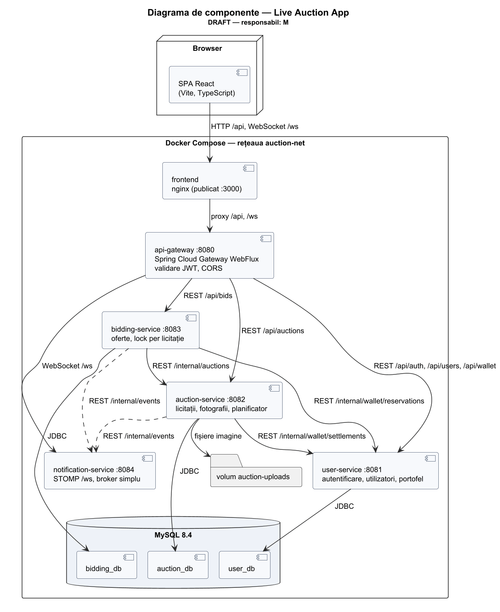
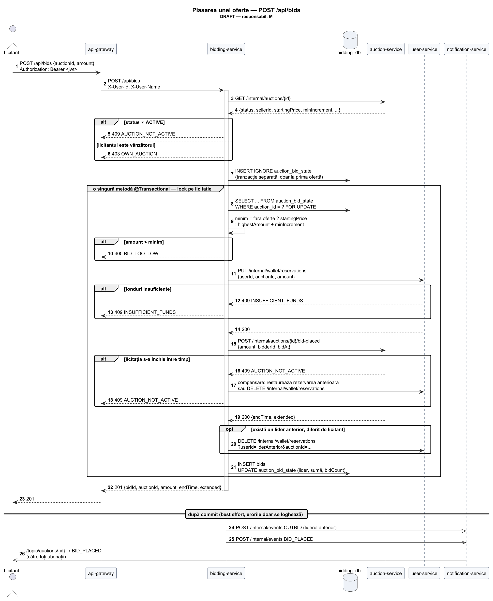
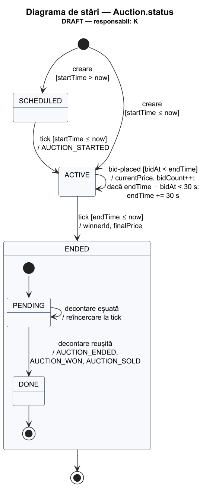
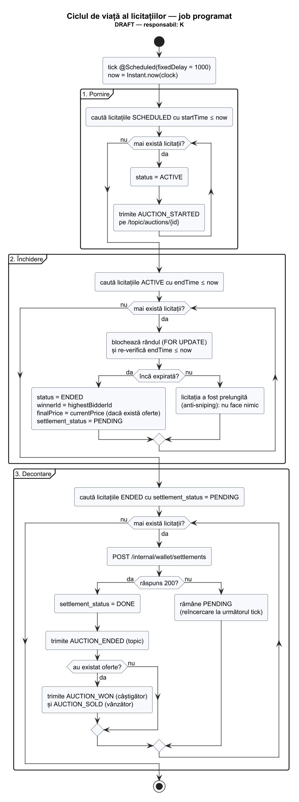
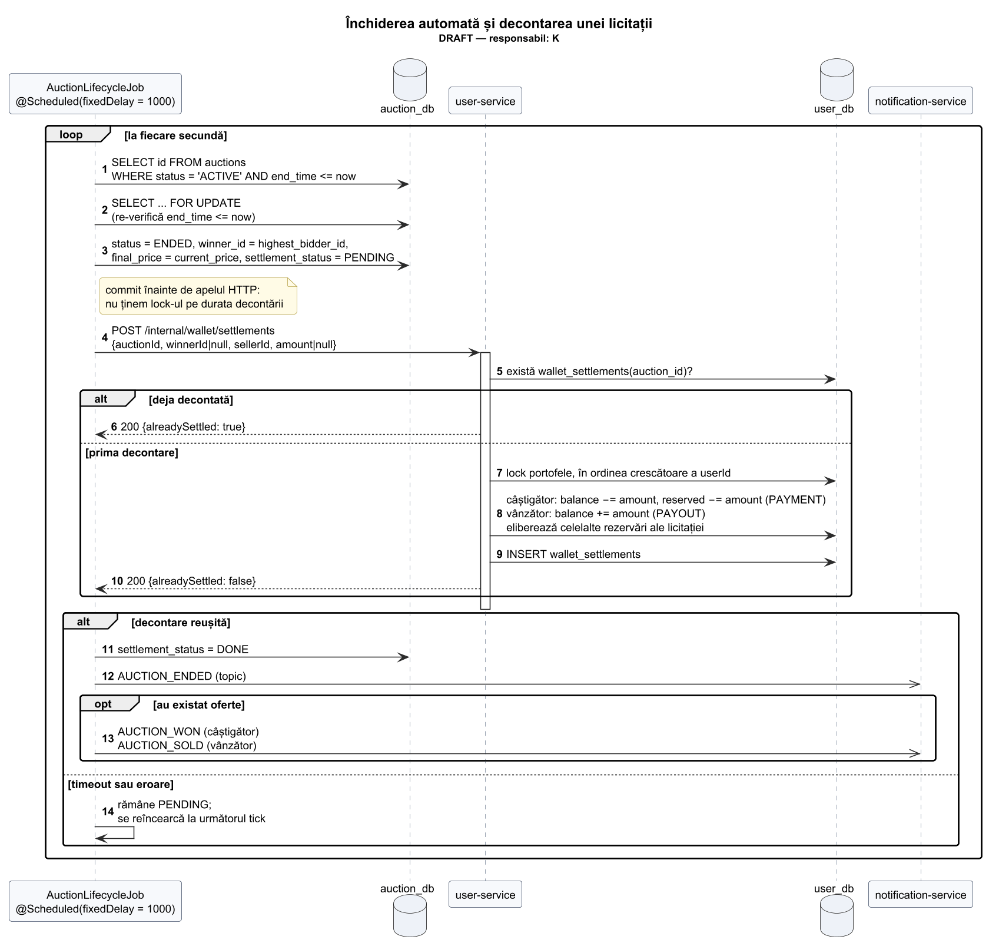

<!-- Responsabil: M (Technical Lead). Cerința (d) a disciplinei: modelarea arhitecturii. Sursă: docs/architecture.md. -->

# Arhitectura sistemului

## Stilul arhitectural

Aplicația are o **arhitectură cu microservicii** [3], [4]:
- funcționalitatea este împărțită în servicii mici, fiecare cu responsabilitatea și datele lui, care comunică prin interfețe bine definite;
- un **API gateway** oferă front-end-ului un punct unic de intrare.

Arhitectura de referință prezentată la curs [1] mai conține Config Server, Service Registry și Circuit Breaker. Echipa a ales să nu le folosească în versiunea inițială:
- cele cinci servicii au adrese fixe în rețeaua Docker Compose, iar numele DNS ale containerelor înlocuiesc service discovery;
- configurația vine din variabile de mediu.

Decizia este documentată în tabelul alternativelor de la secțiunea 4.6.

## Componentele sistemului



Tabelul: Componentele sistemului

| Componentă | Port | Responsabilitate | Date |
|---|---|---|---|
| frontend (React, servit de nginx) | 3000 (5173 în dezvoltare) | interfața web, conexiunea STOMP, cronometrele | — |
| api-gateway (Spring Cloud Gateway) | 8080 | rutare, validarea JWT, propagarea identității, CORS, proxy WebSocket | — |
| user-service | 8081 | conturi, emiterea JWT, portofel, rezervări, decontări | `user_db` |
| auction-service | 8082 | licitații, fotografii, planificatorul ciclului de viață, anti-sniping | `auction_db` |
| bidding-service | 8083 | plasarea ofertelor (lock per licitație), istoricul ofertelor | `bidding_db` |
| notification-service | 8084 | STOMP peste WebSocket: topic public per licitație, coadă privată per utilizator | în memorie |
| MySQL 8.4 | 3306 | o instanță, trei scheme, un utilizator per serviciu | — |

## Comunicarea între componente

**Tipuri de comunicare:**
- **Public, sincron:** browserul apelează gateway-ul prin REST/JSON, iar gateway-ul rutează cererea la serviciul responsabil.
- **Intern, sincron:** serviciile se apelează direct prin REST, pe calea `/internal/**`, cu header-ul `X-Internal-Key`. Gateway-ul nu rutează aceste căi.
- **Notificări:** auction-service și bidding-service trimit evenimente prin `POST /internal/events`. notification-service le difuzează prin STOMP către browsere.

**Clienții HTTP interni** folosesc `RestClient` din Spring Framework 7, cu timeouts de 2 s la conectare și 5 s la citire. Fiecare client este o interfață cu două implementări: una HTTP și una în memorie (profilul `stub`), ca fiecare membru să își poată dezvolta serviciul înainte ca dependențele lui să fie gata.

Tabelul: Apelurile interne dintre servicii

| Apelant | Apelat | Endpoint | Scop |
|---|---|---|---|
| bidding | auction | `GET /internal/auctions/{id}` | validarea ofertei |
| bidding | user | `PUT /internal/wallet/reservations` | rezervarea fondurilor |
| bidding | auction | `POST /internal/auctions/{id}/bid-placed` | actualizarea prețului, anti-sniping |
| bidding | user | `DELETE /internal/wallet/reservations` | eliberarea fostului lider, compensare |
| auction | user | `POST /internal/wallet/settlements` | decontarea la închidere |
| auction, bidding | notification | `POST /internal/events` | evenimente în timp real |

## Plasarea unei oferte

Plasarea unei oferte este fluxul cel mai sensibil, din două motive:
- mai mulți utilizatori pot licita simultan;
- operația implică trei servicii.

bidding-service execută totul într-o singură tranzacție, ținând un **lock pesimist** pe rândul de stare al licitației (`SELECT … FOR UPDATE`).



Pașii fluxului:
1. **Verificarea licitației.** Se citește licitația de la auction-service. Licitația inactivă primește 409, iar licitantul care este și vânzătorul primește 403.
2. **Lock-ul și suma minimă.** Se blochează rândul `auction_bid_state` și se verifică suma minimă: prețul de pornire, sau oferta maximă plus incrementul.
3. **Rezervarea fondurilor** licitantului, în user-service.
4. **Actualizarea licitației** în auction-service, cu aplicarea anti-sniping. Dacă licitația s-a închis între timp, rezervarea se compensează.
5. **Eliberarea fostului lider:** rezervarea lui se eliberează.
6. **Salvarea ofertei** și a noii stări, apoi commit.
7. **Notificările, după commit:** `OUTBID` către fostul lider, `BID_PLACED` către toți cei abonați.

**Regula de bază:** tot ce mișcă bani se întâmplă cât timp se ține lock-ul licitației. Notificările se trimit doar după commit, pentru că pierderea uneia nu afectează corectitudinea.

**Alternativa respinsă:** optimistic locking (`@Version` + reîncercare) ar fi cerut compensări în alte servicii la fiecare conflict [5]. Analiza completă este în ADR-001.

Codul de mai jos arată metoda de repository care obține lock-ul. Spring Data JPA o traduce într-un `SELECT … FOR UPDATE` pe MySQL.

```java
public interface AuctionBidStateRepository extends JpaRepository<AuctionBidState, Long> {

    @Lock(LockModeType.PESSIMISTIC_WRITE)
    @Query("select s from AuctionBidState s where s.auctionId = :auctionId")
    Optional<AuctionBidState> findByIdForUpdate(@Param("auctionId") Long auctionId);
}
```

Codul: Obținerea lock-ului pesimist pe starea unei licitații (bidding-service)

## Ciclul de viață al licitației

O licitație trece prin stările `SCHEDULED` (programată), `ACTIVE` și `ENDED` (încheiată). Tranzițiile sunt făcute de un job programat din auction-service, care rulează la fiecare secundă și folosește un `Clock` injectat, ca să poată fi testat cu timp fix.



**Anti-sniping:** la fiecare ofertă acceptată, dacă până la final au rămas mai puțin de 30 de secunde, sfârșitul se mută cu 30 de secunde mai târziu.

**Închiderea are doi pași separați:**
1. starea devine `ENDED`, cu decontarea marcată `PENDING`;
2. apelul de decontare către user-service se face după commit.

Astfel, lock-ul nu este ținut pe durata unui apel HTTP. Dacă user-service nu răspunde, decontarea rămâne `PENDING` și se reîncearcă la fiecare tick. Pentru că decontarea este idempotentă, nu poate fi aplicată de două ori.





## Comunicarea în timp real

**Conexiunea:** browserul se conectează prin STOMP peste WebSocket la `/ws`. Conexiunea trece prin nginx și prin gateway până la notification-service.

**Destinații:**
- **Topicul public** `/topic/auctions/{id}` primește evenimentele unei licitații: pornire, ofertă nouă, încheiere.
- **Coada privată** `/user/queue/notifications` primește notificările personale: „depășit”, „câștigat”, „vândut”. Este disponibilă doar conexiunilor autentificate cu JWT în cadrul `CONNECT`.

Tabelul: Evenimentele în timp real

| Eveniment | Emitent | Destinație | Conținut |
|---|---|---|---|
| `AUCTION_STARTED` | auction-service | topicul licitației | început, sfârșit |
| `BID_PLACED` | bidding-service | topicul licitației | sumă, licitant, număr de oferte, sfârșit, prelungire |
| `OUTBID` | bidding-service | coada fostului lider | licitația, suma proprie, suma nouă |
| `AUCTION_ENDED` | auction-service | topicul licitației | câștigător, preț final |
| `AUCTION_WON` | auction-service | coada câștigătorului | licitația, preț final |
| `AUCTION_SOLD` | auction-service | coada vânzătorului | licitația, preț final, câștigător |

**Sincronizarea cronometrului:** fiecare mesaj conține `serverTime`. Front-end-ul calculează diferența față de ceasul local și afișează cronometrul după ceasul serverului.

## Alternative considerate

Tabelul: Deciziile de arhitectură și alternativele respinse

| Decizie | Alternativă respinsă | Motiv |
|---|---|---|
| Lock pesimist per licitație | `@Version` + reîncercare | ordinea strictă a ofertelor, fără compensări repetate |
| Autentificare la gateway + cheie internă | validarea JWT în fiecare serviciu | un singur loc pentru securitate, servicii mai simple |
| `RestClient` + profilul `stub` | OpenFeign, WebClient | inclus în Spring Framework 7, model sincron simplu |
| O schemă per serviciu, pe o singură instanță MySQL | schemă comună sau câte o instanță per serviciu | izolare reală între servicii, cost redus de resurse |
| DNS-ul Docker + variabile de mediu | Config Server, Service Registry | 5 servicii fixe într-o singură rețea Compose |
| Notificări REST către notification-service | broker de mesaje (RabbitMQ) | mai puține componente; RabbitMQ rămâne o evoluție posibilă |

## Tehnologii și versiuni

Tabelul: Tehnologiile folosite

| Domeniu | Tehnologie | Versiune |
|---|---|---|
| Limbaj backend | Java (Eclipse Temurin) | 21 LTS |
| Framework backend | Spring Boot (Web MVC, Data JPA, Security, Validation, Actuator, WebSocket) | 4.1.2 |
| Gateway | Spring Cloud Gateway Server WebFlux | Spring Cloud 2025.1.4 |
| Persistență | Hibernate ORM, Flyway, MySQL | 7.4, 11, 8.4 |
| Documentarea API-ului | springdoc-openapi (Swagger UI) | 3.2.0 |
| Front-end | React, TypeScript, Vite, React Router, STOMP.js | 19, 7.0, 8, 7.18, 7.5 |
| Containere | Docker, Docker Compose, nginx | Compose v2, nginx 1.30 |
| CI/CD | GitHub Actions, GitHub Container Registry | — |
| Testare | JUnit, Mockito, Testcontainers, Postman / Newman | JUnit 6, Testcontainers 2 |
