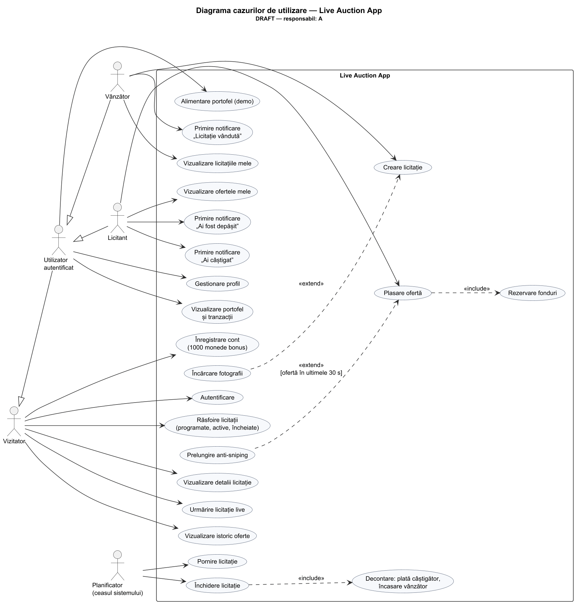

<!-- Responsabil: A (Product Owner). Cerința (d) a disciplinei: diagrama use case. Sursă: docs/uml/use-case.puml. -->

# Diagrama cazurilor de utilizare

## Actori

Tabelul: Actorii sistemului

| Actor | Descriere |
|---|---|
| Vizitator | persoană neautentificată; poate răsfoi și urmări licitațiile, se poate înregistra și autentifica |
| Utilizator autentificat | specializare a vizitatorului; își gestionează profilul și portofelul |
| Vânzător | utilizator autentificat care creează licitații și primește încasarea |
| Licitant | utilizator autentificat care plasează oferte |
| Planificator | actor de sistem (ceasul serverului) care pornește, închide și decontează licitațiile |

Vânzătorul și licitantul sunt roluri ale aceluiași cont: un utilizator poate vinde un obiect și licita la licitațiile altora. Diagrama le separă pentru claritate, prin generalizare din actorul „Utilizator autentificat”.

## Diagrama

Relațiile speciale din diagramă:
- **„Plasare ofertă” include „Rezervare fonduri”:** o ofertă nu poate fi acceptată fără rezervarea sumei.
- **„Prelungire anti-sniping” extinde „Plasare ofertă”:** extensia are loc doar dacă oferta este plasată în ultimele 30 de secunde.
- **„Încărcare fotografii” extinde „Creare licitație”:** vânzătorul poate adăuga fotografii, dar nu este obligat.
- **„Închidere licitație” include „Decontare”:** câștigătorul plătește, vânzătorul încasează.

## Descrierea cazurilor principale

Tabelul: Cazul de utilizare „Plasare ofertă”

| Element | Descriere |
|---|---|
| Actor principal | Licitant |
| Precondiții | licitantul este autentificat; licitația este activă; licitantul nu este vânzătorul |
| Flux principal | 1. Licitantul deschide pagina licitației și vede suma minimă sugerată. 2. Introduce o sumă și confirmă. 3. Sistemul verifică suma minimă și rezervă fondurile. 4. Sistemul actualizează prețul și liderul și aplică anti-sniping. 5. Toți cei care urmăresc licitația văd noua ofertă; fostul lider primește notificarea „Ai fost depășit”. |
| Fluxuri alternative | 3a. Suma este sub minim: mesajul „Oferta minimă este X”. 3b. Fondurile sunt insuficiente: mesajul „Fonduri insuficiente”. 4a. Licitația s-a încheiat între timp: rezervarea se anulează, mesajul „Licitația nu mai este activă”. |
| Postcondiții | licitantul este lider; suma lui este rezervată; rezervarea fostului lider este eliberată |

Tabelul: Cazul de utilizare „Creare licitație”

| Element | Descriere |
|---|---|
| Actor principal | Vânzător |
| Precondiții | vânzătorul este autentificat |
| Flux principal | 1. Vânzătorul completează titlul, descrierea, prețul de pornire, incrementul minim, începutul și sfârșitul. 2. Sistemul validează datele și creează licitația ca programată sau activă. 3. Opțional, vânzătorul încarcă până la 5 fotografii. |
| Fluxuri alternative | 2a. Interval invalid (sfârșit înainte de început sau durată de peste 7 zile): mesaj de eroare. 3a. Fișier de alt tip, peste 5 MB sau a șasea fotografie: încărcarea este refuzată. |
| Postcondiții | licitația apare în lista corespunzătoare stării ei |

Tabelul: Cazul de utilizare „Închidere licitație”

| Element | Descriere |
|---|---|
| Actor principal | Planificator |
| Precondiții | licitația este activă, iar timpul ei a expirat |
| Flux principal | 1. Planificatorul blochează licitația și verifică din nou timpul. 2. Marchează licitația ca încheiată și stabilește câștigătorul și prețul final. 3. Cere decontarea: câștigătorul plătește, vânzătorul încasează, celelalte rezervări se eliberează. 4. Sunt notificați toți cei care urmăresc licitația, câștigătorul și vânzătorul. |
| Fluxuri alternative | 1a. Licitația a fost prelungită între timp: rămâne activă. 3a. Fără oferte: licitația se încheie fără câștigător și fără mișcări de bani. 3b. Serviciul de portofel nu răspunde: decontarea se reia automat la fiecare secundă. |
| Postcondiții | licitația este încheiată și decontată o singură dată |
