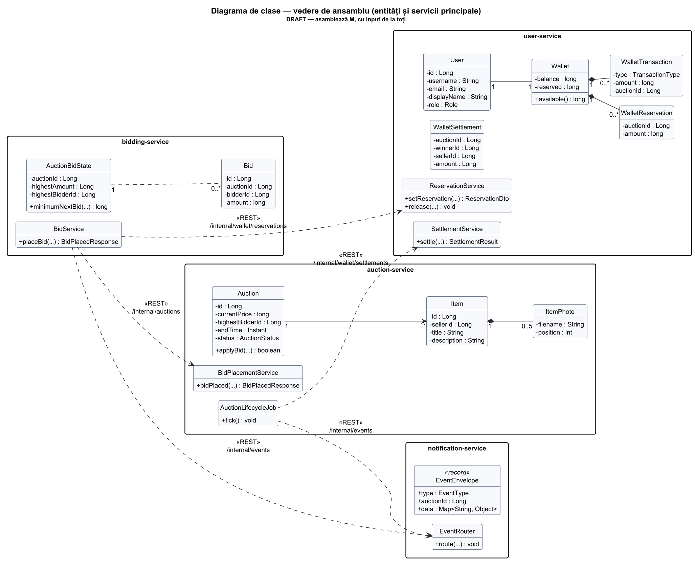
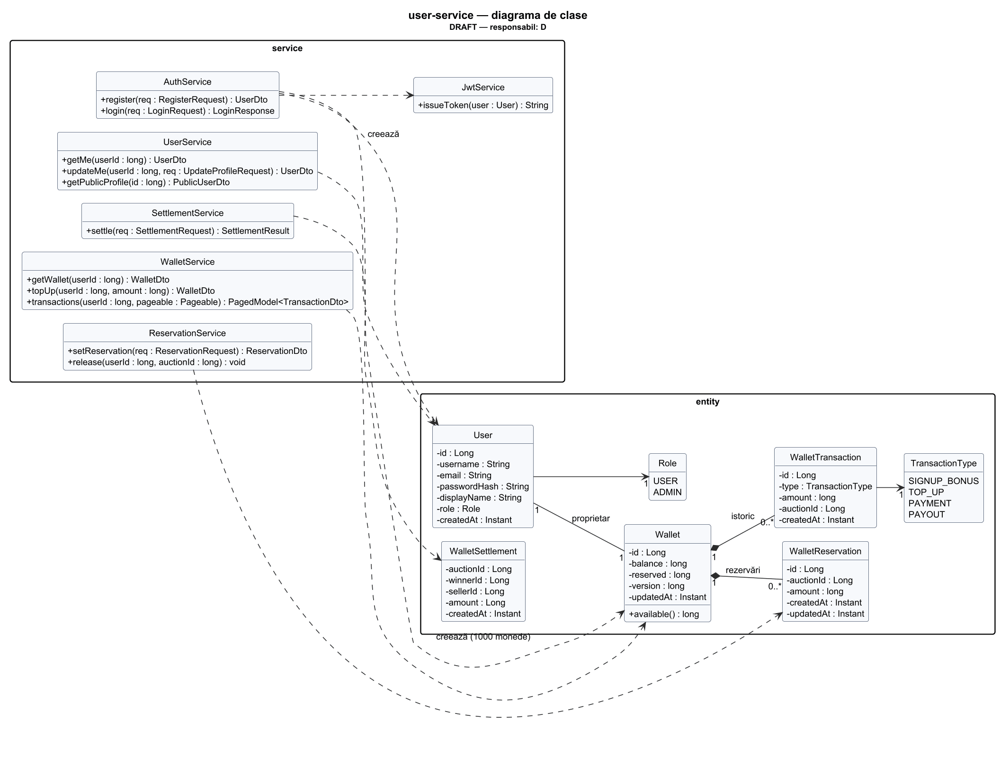
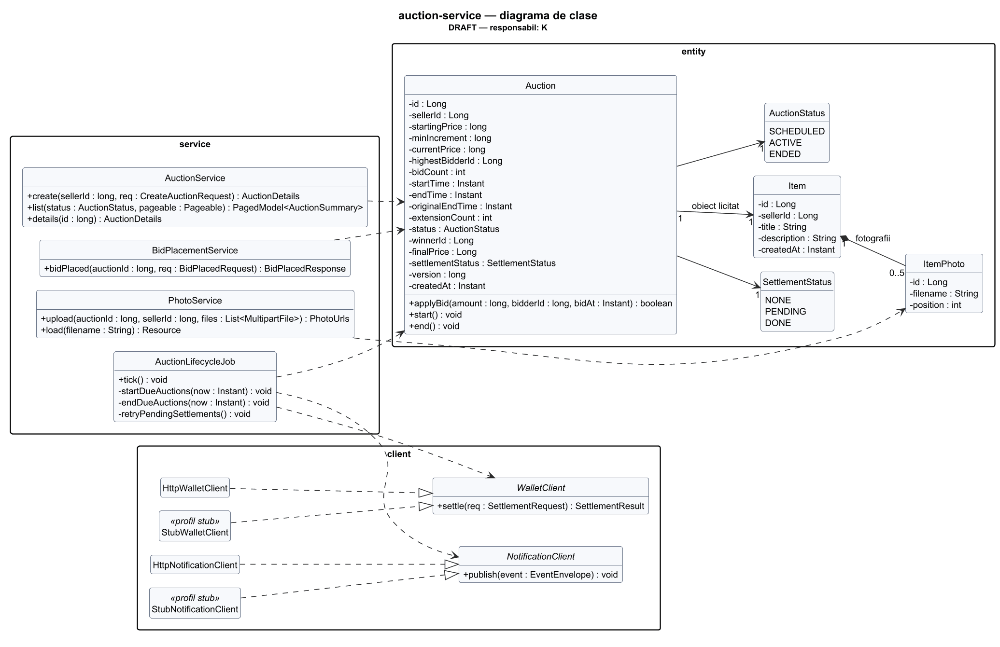
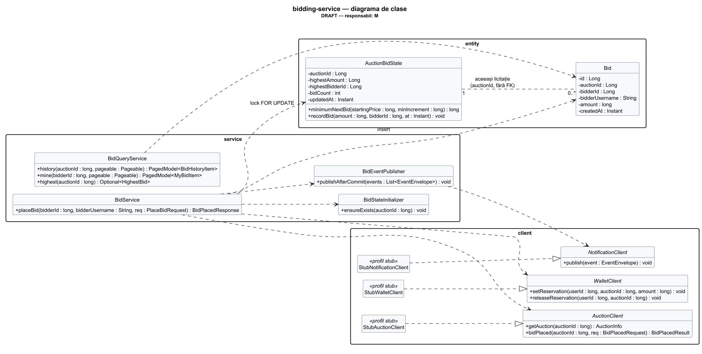
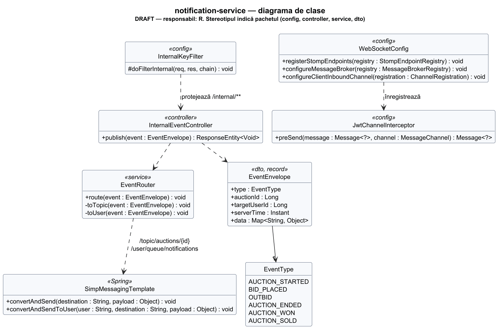

<!-- Responsabil: M (asamblează), cu input de la toți. Cerința (d) a disciplinei: diagrama de clase. Surse: docs/uml/class-*.puml. -->

# Diagrama de clase

## Convenții

Fiecare microserviciu are aceeași structură de pachete sub `ro.unitbv.liveauction.<serviciu>`:
- **`entity`:** entitățile JPA;
- **`repository`:** interfețele Spring Data;
- **`service`:** logica de business, cu tranzacții;
- **`controller`:** endpoint-urile REST;
- **`dto`:** obiectele de transfer, ca înregistrări Java (`record`);
- **`client`:** clienții către alte servicii;
- **`config`** și **`exception`**.

**Ce arată diagramele:** pentru lizibilitate, diagramele prezintă **entitățile și serviciile principale**. Controller-ele doar validează cererea și deleagă serviciului, iar repository-urile sunt interfețe Spring Data standard, așa că sunt omise unde nu aduc informație nouă.

**Notația este cea din curs:**
- trei compartimente: nume, atribute, operații;
- vizibilitate `+` / `-` / `#`;
- multiplicități;
- compoziție (romb plin), dependență (linie punctată), realizarea unei interfețe (linie punctată cu triunghi).

<!-- landscape-start -->

## Vedere de ansamblu

Diagrama de ansamblu arată entitățile principale ale fiecărui serviciu și dependențele dintre servicii. Toate dependențele dintre servicii sunt apeluri REST (stereotipul `<<REST>>`), nu asocieri directe: un serviciu nu poate accesa entitățile altuia.

## user-service

user-service deține utilizatorii și portofelele:
- **relații între entități:** fiecare utilizator are exact un portofel; portofelul compune rezervările și tranzacțiile;
- **`WalletSettlement`:** înregistrează decontările deja făcute, ceea ce face decontarea idempotentă.

## auction-service

- **Entități:** `Auction` păstrează starea curentă a licitației (preț, lider, sfârșit, stare, decontare); `Item` compune până la cinci fotografii (`ItemPhoto`).
- **Servicii:** `AuctionLifecycleJob` implementează ciclul de viață; clienții `WalletClient` și `NotificationClient` au implementări HTTP și stub.

## bidding-service

- **Entități:** `AuctionBidState` este rândul blocat la fiecare ofertă, iar `Bid` este istoricul ofertelor; ele sunt legate doar prin identificatorul licitației, fără asociere JPA.
- **Servicii:** `BidService` orchestrează plasarea ofertei prin cei trei clienți; `BidStateInitializer` creează rândul de stare la prima ofertă, într-o tranzacție separată.

<!-- landscape-end -->

## notification-service

notification-service nu are bază de date:
- primește evenimentele prin `InternalEventController`;
- `EventRouter` le trimite, prin `SimpMessagingTemplate`, fie pe topicul licitației, fie în coada privată a unui utilizator;
- `JwtChannelInterceptor` validează tokenul la conectarea STOMP.

