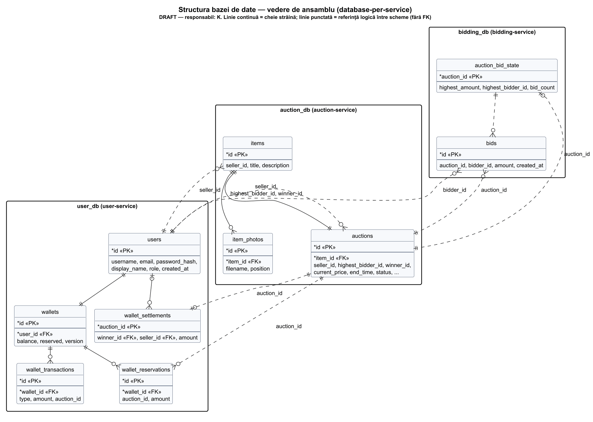
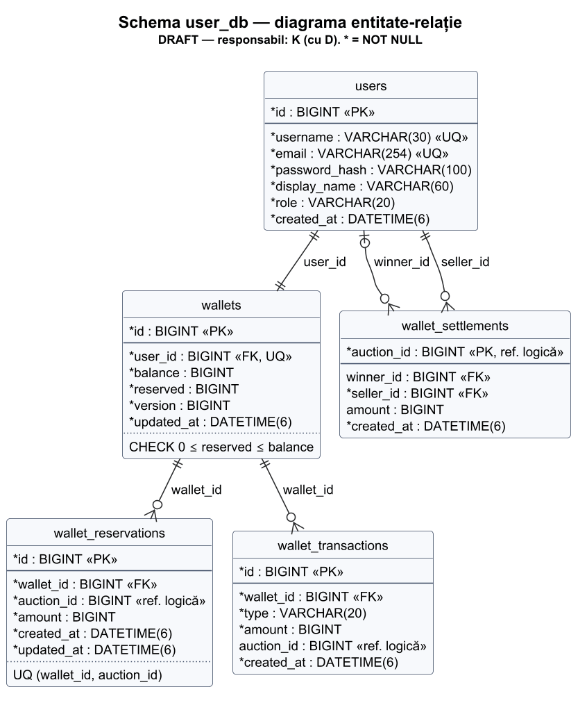
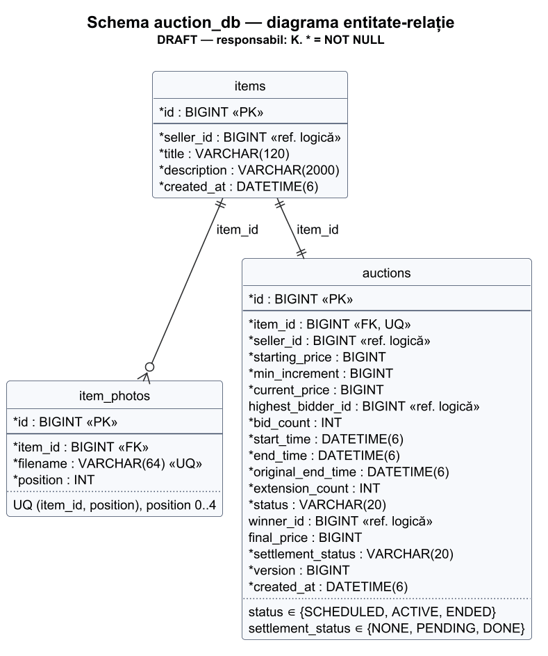
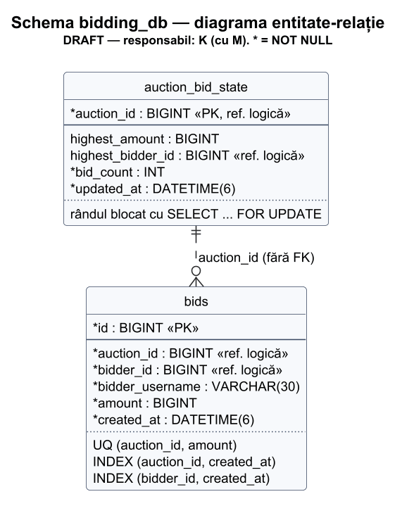

<!-- Responsabil: K. Cerința (c) a disciplinei: structura bazei de date și relațiile dintre tabele. Sursă: docs/database/README.md. -->

# Structura bazei de date

## Principii de proiectare

**Database-per-service.** Fiecare microserviciu care persistă date are propria schemă MySQL și propriul utilizator, cu drepturi doar pe acea schemă:
- `user_db` aparține user-service;
- `auction_db` aparține auction-service;
- `bidding_db` aparține bidding-service.

Un serviciu nu poate citi tabelele altuia; datele altor servicii se obțin prin API. Cele trei scheme stau pe **o singură instanță MySQL 8.4**, ca să economisim memorie pe laptopuri și pe mașina virtuală din cloud. Se poate trece oricând la instanțe separate, schimbând doar adresa de conectare.

**Convenții:**
- motorul InnoDB, setul de caractere `utf8mb4`;
- chei primare `BIGINT AUTO_INCREMENT`;
- momentele de timp ca `DATETIME(6)` în UTC;
- sumele de bani ca `BIGINT`, fără zecimale;
- enumerările ca `VARCHAR`, cu constrângeri `CHECK`;
- constrângeri cu nume explicite (`pk_`, `fk_`, `uq_`, `ck_`, `ix_`).

**Fără chei străine între scheme.** Identificatorii din alte servicii sunt **referințe logice**, adică simple coloane `BIGINT`. De exemplu, `auction_id` din `wallet_reservations` sau `bidder_id` din `bids`. Consistența lor este asigurată de fluxurile de business (capitolul 4).

În diagramele de mai jos, liniile continue sunt chei străine reale, iar liniile punctate sunt referințe logice între scheme. Notația este crow's foot, ca în MySQL Workbench.

{landscape}

## Schema user_db



Tabelul: Tabelele schemei user_db

| Tabel | Rol | Chei și constrângeri importante |
|---|---|---|
| `users` | conturile utilizatorilor | PK `id`; UQ `username`, UQ `email`; `role` ∈ {USER, ADMIN} |
| `wallets` | portofelul (sold și sumă rezervată) | FK `user_id` → `users` (UQ, relație 1:1); CHECK `0 ≤ reserved ≤ balance`; `version` pentru optimistic locking |
| `wallet_reservations` | suma rezervată de un utilizator pentru o licitație | FK `wallet_id` → `wallets`; UQ (`wallet_id`, `auction_id`); `amount > 0` |
| `wallet_transactions` | istoricul mișcărilor de bani | FK `wallet_id` → `wallets`; `type` ∈ {SIGNUP_BONUS, TOP_UP, PAYMENT, PAYOUT}; index (`wallet_id`, `created_at`) |
| `wallet_settlements` | decontările deja efectuate | PK `auction_id` (idempotența decontării); FK `winner_id`, `seller_id` → `users` |

**Relații:**
- `users` 1 — 1 `wallets`;
- `wallets` 1 — 0..* `wallet_reservations` și 1 — 0..* `wallet_transactions`;
- `users` 1 — 0..* `wallet_settlements`, ca vânzător și, opțional, ca și câștigător.

## Schema auction_db



Tabelul: Tabelele schemei auction_db

| Tabel | Rol | Chei și constrângeri importante |
|---|---|---|
| `items` | obiectul licitat | PK `id`; `seller_id` (referință logică), index |
| `item_photos` | fotografiile obiectului | FK `item_id` → `items` (ON DELETE CASCADE); UQ `filename`; UQ (`item_id`, `position`); `position` între 0 și 4 |
| `auctions` | starea licitației | FK `item_id` → `items` (UQ, relație 1:1); `status` ∈ {SCHEDULED, ACTIVE, ENDED}; `settlement_status` ∈ {NONE, PENDING, DONE}; CHECK-uri pe prețuri și intervale; indexuri (`status`, `start_time`) și (`status`, `end_time`) |

**Relații:** `items` 1 — 0..5 `item_photos` și `items` 1 — 1 `auctions`.

**Indexuri pentru job:** cele pe `status` cu `start_time` și `end_time` permit jobului care rulează la fiecare secundă să găsească rapid licitațiile care trebuie pornite sau închise.

## Schema bidding_db



Tabelul: Tabelele schemei bidding_db

| Tabel | Rol | Chei și constrângeri importante |
|---|---|---|
| `bids` | istoricul ofertelor | PK `id`; UQ (`auction_id`, `amount`); indexuri (`auction_id`, `created_at`) și (`bidder_id`, `created_at`) |
| `auction_bid_state` | starea curentă a licitării, blocată la fiecare ofertă | PK `auction_id`; CHECK: liderul și suma sunt nule dacă și numai dacă nu există oferte |

**De ce un tabel separat de stare:**
- lock-ul se ia pe un singur rând per licitație, deci ofertele la licitații diferite nu se blochează reciproc;
- suma minimă se calculează fără parcurgerea istoricului.

**Plasa de siguranță:** constrângerea unică (`auction_id`, `amount`) face ca o eventuală eroare de concurență, adică două oferte egale acceptate, să eșueze la inserare în loc să corupă datele.

## Constrângeri de integritate pentru operațiile critice

Tabelul: Cum protejează schema operațiile critice

| Operație | Protecție |
|---|---|
| Oferte simultane la aceeași licitație | `SELECT … FOR UPDATE` pe `auction_bid_state` + UQ (`auction_id`, `amount`) |
| Cheltuirea acelorași fonduri de două ori | rezervări per licitație + CHECK `reserved ≤ balance` + lock pe portofel |
| Decontare repetată la reîncercare | cheia primară `wallet_settlements.auction_id` |
| Deadlock la decontare | portofelele se blochează în ordinea crescătoare a identificatorului utilizatorului |
| Ofertă după închidere | `bid-placed` blochează rândul licitației și respinge ofertele cu `bidAt ≥ end_time` |

## Migrații

**Flyway** [6] creează și versionează schemele:
- fiecare serviciu are fișierele SQL în `src/main/resources/db/migration`;
- Flyway le aplică la pornire;
- Hibernate doar **validează** schema (`ddl-auto: validate`), deci nu o modifică niciodată.

**Reguli de versionare:**
- prima versiune (`V1__init.sql`) poate fi modificată până la 30.11.2026;
- după această dată, orice schimbare se face printr-o migrație nouă (`V2__…`), ca bazele de date ale colegilor să nu devină incompatibile.

Exemplul de mai jos este migrația care creează tabelul de stare al licitării.

```sql
CREATE TABLE auction_bid_state (
    auction_id        BIGINT      NOT NULL,
    highest_amount    BIGINT      NULL,
    highest_bidder_id BIGINT      NULL,
    bid_count         INT         NOT NULL DEFAULT 0,
    updated_at        DATETIME(6) NOT NULL,
    CONSTRAINT pk_auction_bid_state PRIMARY KEY (auction_id),
    CONSTRAINT ck_auction_bid_state_leader CHECK ((bid_count = 0 AND highest_amount IS NULL AND highest_bidder_id IS NULL)
        OR (bid_count > 0 AND highest_amount IS NOT NULL AND highest_bidder_id IS NOT NULL))
) ENGINE = InnoDB DEFAULT CHARSET = utf8mb4 COLLATE = utf8mb4_0900_ai_ci;
```

Codul: Migrația Flyway pentru tabelul auction_bid_state (bidding-service)

**Crearea schemelor și a utilizatorilor:** la prima pornire a containerului MySQL, scriptul `db/init/01-init.sh` creează cele trei scheme și câte un utilizator per serviciu. Fiecare utilizator are drepturi doar pe schema proprie.
