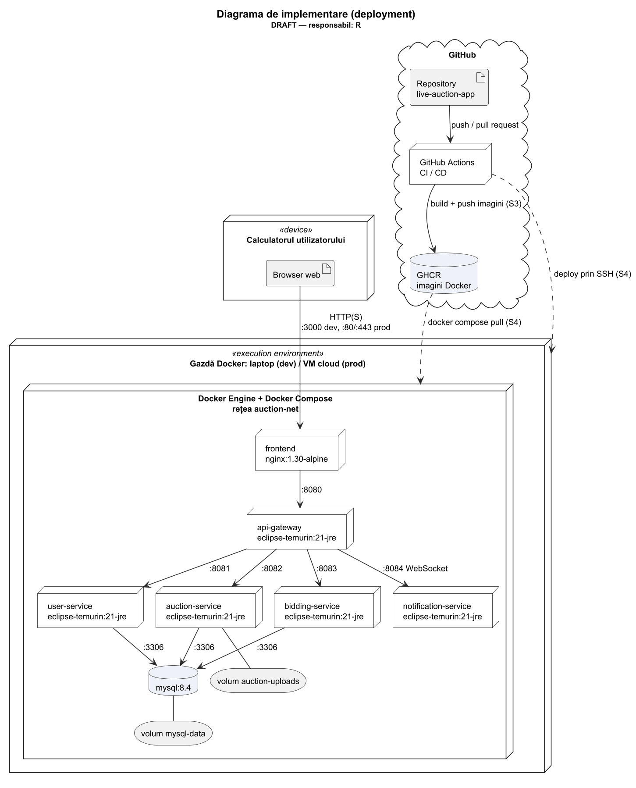

<!-- Responsabil: R (DevOps Engineer). -->

# Infrastructură: Docker, Docker Compose, CI/CD și cloud

## Containerizare

Fiecare microserviciu are un **Dockerfile multi-stage**:
1. **Etapa de build:** pornește de la imaginea `eclipse-temurin:21-jdk`, compilează proiectul cu Maven Wrapper și produce un JAR executabil. Dependențele Maven sunt păstrate între build-uri printr-un cache BuildKit.
2. **Etapa de rulare:** folosește doar imaginea `eclipse-temurin:21-jre`, mai mică, și rulează aplicația cu un utilizator fără drepturi de administrator.

**Memoria JVM-ului:** opțiunea `-XX:MaxRAMPercentage=75` adaptează memoria JVM-ului la limita containerului.

**Front-end-ul:** se construiește cu `node:24-alpine` și este servit de `nginx:1.30-alpine`. nginx face și proxy pentru `/api` și `/ws` către gateway, deci aplicația folosește doar adrese relative.

Tabelul: Imaginile Docker ale aplicației

| Container | Imagine de bază | Port intern | Publicat în dezvoltare |
|---|---|---|---|
| frontend | nginx:1.30-alpine | 80 | 3000 |
| api-gateway | eclipse-temurin:21-jre | 8080 | 8080 |
| user-service | eclipse-temurin:21-jre | 8081 | 8081 |
| auction-service | eclipse-temurin:21-jre | 8082 | 8082 |
| bidding-service | eclipse-temurin:21-jre | 8083 | 8083 |
| notification-service | eclipse-temurin:21-jre | 8084 | 8084 |
| mysql | mysql:8.4 | 3306 | 3306 |

## Docker Compose

**Pornire:** fișierul `docker-compose.yml` descrie întreaga aplicație, care pornește cu o singură comandă: `docker compose up -d --build`.

**Caracteristici:**
- **Rețea:** toate containerele sunt în rețeaua `auction-net` și se găsesc după nume (de exemplu `http://user-service:8081`).
- **Volume:** `mysql-data` păstrează datele, iar `auction-uploads` păstrează fotografiile.
- **Healthcheck-uri:** fiecare serviciu are un healthcheck (`/actuator/health`). Pornirea respectă dependențele (`depends_on` cu `condition: service_healthy`): baza de date, apoi serviciile, apoi gateway-ul, apoi front-end-ul.
- **Limite de memorie:** fiecare serviciu Java are o limită de 512 MB, ca aplicația să ruleze pe laptopurile echipei.
- **Configurație:** vine din fișierul `.env`, care nu se pune în depozit. Valorile de dezvoltare sunt în `.env.example`.

**Fișiere suplimentare:**
- **`docker-compose.override.yml`** se încarcă automat în dezvoltare și publică portul MySQL și porturile serviciilor, pentru testare directă și Swagger UI.
- **`docker-compose.prod.yml`** este folosit în cloud: imagini din registry și doar front-end-ul publicat.

## Integrare continuă

GitHub Actions rulează workflow-ul `ci.yml` la fiecare push și la fiecare pull request spre `develop` sau `main`:
1. **Detectarea modificărilor:** un prim job află ce componente s-au schimbat.
2. **Backend:** fiecare serviciu modificat se compilează și se testează în paralel (`./mvnw -B verify`, JDK 21, cache Maven).
3. **Front-end:** dacă s-a modificat, se rulează `npm ci` și `npm run build`.
4. **Pull request spre `main`:** construiește întotdeauna toate componentele.

**Required status checks:** în S3, verificările CI devin obligatorii pentru integrarea în `develop` și `main`.

## Livrare continuă și cloud

**Planul de livrare (S3–S4):**
1. La fiecare push pe `main`, GitHub Actions construiește imaginile Docker și le publică în GitHub Container Registry (GHCR).
2. Pe o mașină virtuală din cloud, un job de livrare se conectează prin SSH și rulează `docker compose -f docker-compose.yml -f docker-compose.prod.yml pull` și apoi `up -d`.
3. Un test de verificare (smoke test) confirmă că aplicația răspunde.

**Regulile mediului de cloud:**
- sunt deschise doar porturile 80, 443 și 22;
- secretele de producție stau în fișierul `.env` al mașinii virtuale și în GitHub Secrets.

Alegerea furnizorului este documentată în ADR-005 (DevOps Engineer, S2), pe baza criteriilor din tabelul de mai jos.

Tabelul: Criteriile de alegere a platformei de cloud

| Criteriu | Cerință |
|---|---|
| Cost | acoperit de creditele sau ofertele pentru studenți |
| Resurse | cel puțin 2 vCPU și 4 GB RAM pentru 7 containere (sau 8 GB fără limite stricte) |
| Acces | mașină virtuală Linux cu Docker, acces SSH din GitHub Actions |
| Rețea | IP public, posibilitatea de a configura un domeniu și HTTPS |

## Testare

Tabelul: Nivelurile de testare

| Nivel | Instrument | Ce verifică |
|---|---|---|
| Unitar | JUnit 6, Mockito | logica serviciilor, cu clienții externi simulați |
| Context | Spring Boot Test, H2 | pornirea fiecărui serviciu, fără MySQL și fără Docker |
| Integrare cu baza de date | Testcontainers MySQL 8.4 | migrațiile Flyway, maparea entităților, concurența (50 de oferte paralele) |
| API | Postman, Newman în CI | fiecare endpoint public, cu aserțiuni; scenariul complet de licitare |
| End-to-end | front-end + pagina de test WebSocket | scenariul de demonstrație cu două browsere |
