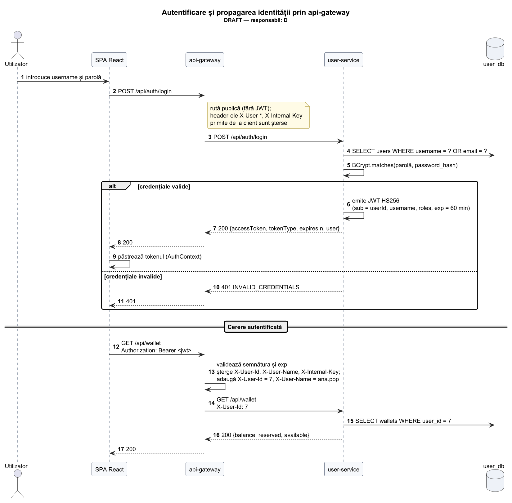

<!-- Responsabil: D. -->

# Securitate

## Autentificare

**Înregistrarea:** user-service salvează parola doar ca **hash BCrypt**, niciodată în clar.

**Autentificarea:**
- user-service verifică parola și emite un **JSON Web Token** [7], semnat cu algoritmul HS256 și valabil 60 de minute.
- Tokenul conține identificatorul utilizatorului (`sub`), numele de utilizator și rolurile.
- Front-end-ul trimite tokenul în header-ul `Authorization: Bearer …` la fiecare cerere protejată.

## Autorizare și propagarea identității

**api-gateway este singurul punct de intrare** și validează tokenul pentru tot traficul HTTP:
- **Rute publice:** autentificarea, citirea licitațiilor și a istoricului de oferte, conexiunea WebSocket, starea aplicației. Funcționează și fără token.
- **Rute protejate:** orice altă rută `/api/**` fără token valid primește **401**, cu un răspuns în format RFC 9457 [8].

**Propagarea identității:**
1. Gateway-ul **șterge** header-ele `X-User-Id`, `X-User-Name` și `X-Internal-Key` trimise de client. Astfel, nimeni nu se poate da drept alt utilizator.
2. Apoi adaugă `X-User-Id` și `X-User-Name` din tokenul validat.
3. Serviciile din spatele gateway-ului folosesc aceste header-e și nu mai parsează tokenul (ADR-002).

## API-ul intern

**Protecția căilor `/internal/**`:**
- nu sunt rutate de gateway, deci primesc 404 din exterior;
- cer header-ul `X-Internal-Key`, cu o cheie secretă partajată de servicii.

**În producție:** porturile serviciilor nu sunt publicate. Ele sunt accesibile doar în rețeaua internă Docker.

## Comunicarea WebSocket

Gateway-ul doar transmite conexiunea WebSocket, deci notification-service validează el însuși tokenul trimis în cadrul STOMP `CONNECT`:
- **cu token valid:** numele conexiunii devine identificatorul utilizatorului, iar coada privată de notificări devine disponibilă;
- **fără token:** conexiunea se poate abona doar la topicurile publice ale licitațiilor;
- **origini acceptate:** conexiunile sunt acceptate doar de la originile configurate.

## Protecția datelor și a fișierelor

- **Validare:** fiecare cerere este validată (Bean Validation). Erorile au un format uniform, cu un cod stabil (de exemplu `BID_TOO_LOW`), fără detalii interne.
- **Fotografii:**
  - se acceptă doar tipurile jpeg, png și webp, de maximum 5 MB și cel mult 5 per licitație;
  - fișierele se salvează sub nume UUID aleatoare, niciodată sub numele trimis de client, ceea ce previne atacurile prin căi de fișier.
- **CORS:** se configurează doar la gateway, pentru originile front-end-ului.
- **Secrete:** cheia JWT, cheia internă și parolele bazei de date vin din variabile de mediu; fișierul `.env` nu intră în depozit.
- **Baza de date:** fiecare serviciu are un utilizator MySQL cu drepturi doar pe schema proprie.

## Riscuri de securitate și măsuri

Tabelul: Riscuri de securitate (după OWASP Top 10) și măsurile luate

| Risc [9] | Măsură |
|---|---|
| Control de acces defectuos | validarea JWT la gateway; identitatea vine doar din token; vânzătorul nu își poate licita propria licitație; doar vânzătorul își modifică licitația |
| Defecte criptografice | BCrypt pentru parole; secret JWT de cel puțin 32 de octeți; HTTPS în producție |
| Injecție | interogări parametrizate prin JPA; validarea tuturor datelor de intrare |
| Design nesigur | rezervarea fondurilor și lock-urile împiedică cheltuirea dublă; operațiile financiare sunt idempotente |
| Configurare greșită | nimic publicat în producție în afară de front-end; Swagger UI doar în dezvoltare |
| Identificare și autentificare | mesaj identic pentru utilizator inexistent și parolă greșită; tokenuri cu expirare |
| Componente vulnerabile | versiuni actuale (Spring Boot 4.1.2, Java 21); actualizări prin pull request-uri verificate în CI |

**Limitări acceptate:**
- tokenul nu poate fi revocat înainte de expirare;
- secretul JWT este partajat între servicii.

O evoluție posibilă este semnarea cu RS256 și publicarea cheii publice (JWKS), plus tokenuri de reîmprospătare.
