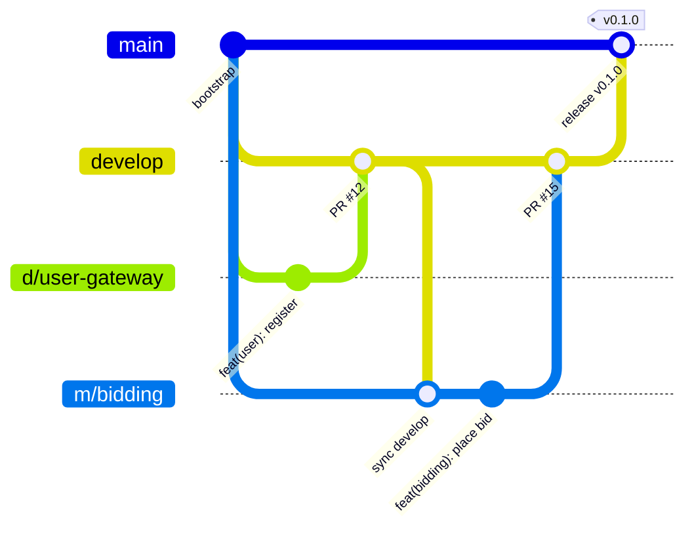

# Echipa Live Auction App: organizare

Pagina comună a echipei. **Ghidul tău personal** este în `docs/team/<ID>.md`. Fișierul `.md` este sursa; versiunile Word/PDF din [docx/](docx/) sunt copii generate, doar pentru citit sau printat:

| ID | Membru | Rol | Componente | Ramură | Ghid |
|---|---|---|---|---|---|
| D | Pilat David Sebastian | Project Manager | `user-service`, `api-gateway` | `d/user-gateway` | [D.md](D.md) |
| M | Mituleci Tudor | Technical Lead | `bidding-service`, contracte, arhitectură | `m/bidding` | [M.md](M.md) |
| K | Kubanda Andrei | Scrum Master | `auction-service`, baza de date | `k/auction` | [K.md](K.md) |
| A | Nicolescu Andreas | Product Owner | `frontend`, backlog | `a/frontend` | [A.md](A.md) |
| R | Luncașu Răzvan | DevOps Engineer | `notification-service`, Docker, CI/CD, cloud, Postman | `r/devops` | [R.md](R.md) |

## Ce citești și când

Repository-ul are multă documentație, dar **nu trebuie citită toată**. Citește la început doar lista de mai jos (aproximativ 40 de minute); restul îl deschizi când lucrezi la ceva anume.

**La început (toți):**

| Document | Timp | De ce |
|---|---|---|
| [README.md](../../README.md) | 5 min | ce face aplicația și cum o pornești |
| această pagină | 10 min | cum lucrăm: calendar, întâlniri, Definition of Done, depanare |
| ghidul tău `docs/team/<ID>.md` | 15 min | task-urile tale, pe sprinturi (citește în detaliu doar sprintul curent) |
| [CONTRIBUTING.md](../../CONTRIBUTING.md) | 5 min | ramuri, commit-uri, PR-uri |
| secțiunile tale din [api-contracts.md](../api-contracts.md) | 5 min | endpoint-urile pe care le implementezi sau le apelezi |

**De consultat la nevoie:**

| Document | Când îl deschizi | Cine are nevoie mai ales |
|---|---|---|
| [api-contracts.md](../api-contracts.md) complet | apelezi alt serviciu sau schimbi un contract | toți |
| [architecture.md](../architecture.md), [decisions/](../decisions/) (ADR-uri) | vrei să înțelegi de ce e construit așa | M, apoi toți |
| [database/README.md](../database/README.md) | lucrezi la tabele sau migrații | K, D, M |
| [uml/](../uml/), [diagrams/png/](../diagrams/png/) | desenezi sau actualizezi diagrame | M, A, K |
| [product/backlog.md](../product/backlog.md) | scrii sau verifici user stories | A |
| [raport-tehnic/](../raport-tehnic/), [project-charter/](../project-charter/) | scrii capitolul tău din Raport | autorul capitolului, D |

**Nu trebuie citite:** `CLAUDE.md` și `AGENTS.md` (instrucțiuni pentru asistenții AI) și README-urile din `tools/` și `scripts/` (unelte folosite de D).

**Sursa de adevăr:** arhitectura și baza de date apar și în Raportul Tehnic. După predarea din 30.11 se actualizează doar [architecture.md](../architecture.md) și [database/README.md](../database/README.md); Raportul rămâne versiunea predată.

## 1. Cine răspunde de ce

R = execută, A = răspunde și aprobă, C = consultat, I = informat.

| Zonă | D | M | K | A | R |
|---|---|---|---|---|---|
| Planificare, termene, riscuri, release-uri | A/R | C | C | C | C |
| Contracte API, arhitectură, ADR-uri | C | A/R | C | C | C |
| Backlog, user stories, acceptanță | C | C | C | A/R | I |
| Ceremonii Scrum, board | C | I | A/R | C | I |
| user-service, api-gateway | R | A | I | C | I |
| auction-service, designul bazei de date | C | A | R | I | I |
| bidding-service | C | A/R | C | I | I |
| frontend | I | A | I | R | I |
| notification-service, Docker, CI/CD, cloud, Postman | C | A | I | I | R |
| Raport Tehnic | A/R | R | R | R | R |

## 2. Strategia de ramuri



**Regulile:**
- **Ramura ta:** lucrezi pe ea și o actualizezi cu `develop` după fiecare merge.
- **PR-uri:** deschizi PR spre `develop`. Doar D deschide PR din `develop` spre `main`, la final de sprint.
- **Detalii:** comenzile complete sunt în [CONTRIBUTING.md](../../CONTRIBUTING.md).

## 3. Calendarul sprinturilor

| Sprint | Perioada | Obiectiv | Termene ale disciplinei |
|---|---|---|---|
| S0 Setup | 28.10–08.11.2026 | toți rulează stack-ul local; rolurile și tema sunt prezentate | Ședința 3 (02/09.11); tema în Excel până la **09.11** |
| S1 Design & fundații | 09.11–22.11.2026 | diagramele use case și de clase; designul bazei de date; contractele v1 înghețate; entități și CRUD; autentificare + JWT la gateway | Ședințele 4–5 |
| S2 Fluxuri de bază | 23.11–06.12.2026 | licitații, ciclul de viață, licitare cu rezervări, difuzare WebSocket, stack complet în Compose, CI verde | **Raport Tehnic 30.11** (intern 27.11) |
| S3 Timp real & integrare | 07.12–20.12.2026 | anti-sniping, închidere + decontare, notificări, pagina live, Postman complet | Ședințele 6–7: prezentarea stadiului |
| — | 21.12.2026–03.01.2027 | vacanță (tampon opțional) | — |
| S4 Cloud & final | 04.01–17.01.2027 | implementare în cloud + CD, teste, demo | prezentarea finală |

## 4. Întâlniri și comunicare

| Ce | Când | Cine conduce |
|---|---|---|
| Stand-up asincron în chat: **Ieri / Azi / Blocaje** | zilnic, până la 22:00 | K |
| Sprint planning (45 min) | prima zi a sprintului | K (A aduce prioritățile) |
| Sprint review + retrospectivă (45 min) | ultima zi a sprintului | K, A |
| Check-in PM–SM (15 min) | săptămânal | D |
| Zi de integrare („merge day”) | o dată pe sprint, înainte de review | M |

**Unde se discută ce:**
- **GitHub este sursa de adevăr:** sarcinile sunt issues; discuțiile tehnice au loc în PR-uri și issues.
- **Deciziile** se scriu în ADR-uri sau în documentație, nu rămân în chat.

**Cine îți face review (autor → reviewer):** D → M · M → D · K → M · A → K · R → D.

## 5. Definition of Done (pentru orice task)

- [ ] compilează și testele trec local: `./mvnw -B verify` / `npm run build`;
- [ ] criteriile „Gata când…” sunt îndeplinite;
- [ ] logica nouă are teste;
- [ ] `docs/api-contracts.md` e actualizat dacă s-a schimbat un contract (aprobat de M);
- [ ] colecția Postman e actualizată pentru endpoint-urile noi;
- [ ] nu există secrete în cod;
- [ ] PR-ul e aprobat, CI-ul e verde, issue-ul se închide cu `Closes #…`;
- [ ] funcționează în stack-ul complet: `docker compose up -d --build`.

## 6. Registrul riscurilor

| Risc | Probabilitate / impact | Măsuri | Responsabil |
|---|---|---|---|
| Integrare târzie (serviciile merg separat, nu împreună) | mare / mare | contracte înghețate în S1, profil `stub`, zi de integrare în fiecare sprint, CI pe fiecare push | M |
| Erori de concurență la licitare (doi lideri, bani rezervați greșit) | medie / mare | lock pesimist, `UQ (auction_id, amount)`, test cu 50 de oferte paralele | M |
| Docker pe Windows (memorie, WSL2, porturi) | mare / medie | `.wslconfig`, `mem_limit`, secțiunea de depanare de mai jos, R ca prim suport | R |
| Limitele mediului de cloud | medie / medie | prima implementare încă din S3, imagini JRE, un singur MySQL | R |
| Indisponibilitatea unui membru | medie / mare | task-uri mici în issues, ghiduri detaliate, review încrucișat, redistribuire la planning | D |
| Spring Boot 4 diferă de tutorialele pentru Boot 3 | mare / mică | caseta „Boot 4 vs. Boot 3” din fiecare ghid, `CLAUDE.md` | M |

## 7. Lista pentru prima zi (toți)

- [ ] Acceptă invitația la repository (email de la GitHub sau <https://github.com/seba-dvd/live-auction-app/invitations>).
- [ ] Instalează: Git, Docker Desktop (cu WSL2 pe Windows), JDK 21, IntelliJ IDEA, Node 24 LTS (A și cine lucrează la front-end), Postman.
- [ ] Clonează repository-ul, `git checkout <ramura-ta>`, `cp .env.example .env`.
- [ ] Pornește stack-ul cu `docker compose up -d --build`. Verifică <http://localhost:8080/actuator/health> și <http://localhost:3000>.
- [ ] Citește documentele din [Ce citești și când](#ce-citești-și-când) (aproximativ 40 de minute); restul doar la nevoie.
- [ ] Scrie în chat „setup gata” sau ce nu merge (R te ajută).

## 8. Depanare

**Docker Desktop consumă prea multă memorie sau e foarte lent (Windows)**
1. Creează fișierul `%UserProfile%\.wslconfig` cu:
   ```ini
   [wsl2]
   memory=6GB
   processors=4
   ```
2. Rulează `wsl --shutdown` și repornește Docker Desktop.
3. Stack-ul complet are nevoie de aproximativ 3–4 GB.

**Docker Desktop nu pornește („Inference manager … cannot be accessed”)**
1. Închide Docker Desktop.
2. Șterge fișierele `%LOCALAPPDATA%\Docker\run\dockerInference` și `userAnalyticsOtlpHttp.sock` (rămase de la o sesiune veche). Windows de obicei refuză („The file cannot be accessed by the system”), așa că șterge-le din WSL, în PowerShell (înlocuiește `<user>` cu numele folderului tău din `C:\Users`):
   ```powershell
   wsl -d docker-desktop -- rm -f /mnt/host/c/Users/<user>/AppData/Local/Docker/run/dockerInference /mnt/host/c/Users/<user>/AppData/Local/Docker/run/userAnalyticsOtlpHttp.sock
   wsl --terminate docker-desktop
   ```
3. Repornește Docker Desktop.

**„port is already allocated” / „address already in use”**
- **Găsește procesul:** în PowerShell, `netstat -ano | findstr :3306`.
- **MySQL instalat local pe 3306:** pune `MYSQL_HOST_PORT=3307` în `.env` și `DB_PORT=3307` în run configuration-ul din IntelliJ.

**`./mvnw: /bin/sh^M: bad interpreter` sau `permission denied`**
- **Cauza:** fișierul are sfârșituri de linie CRLF sau nu are drept de execuție.
- **Rezolvarea:** repository-ul forțează LF (`.gitattributes`). Rulează `git config core.autocrlf false && git rm --cached -r . && git reset --hard`. Atenție: comanda pierde modificările necomise. Apoi rulează `chmod +x mvnw`.

**Flyway: „Validate failed: Migration checksum mismatch”**
- **Cauza:** cineva a modificat un `V1__init.sql` deja aplicat la tine.
- **Rezolvarea:** până la 30.11, resetează baza cu `docker compose down -v`, apoi `docker compose up -d`. După 30.11 se scriu doar migrații noi, `V2__…`.

**Vrei să pornești de la zero**
- **Comanda:** `docker compose down -v` (șterge baza de date și fotografiile), apoi `docker compose up -d --build`.

**Un serviciu e „unhealthy”**
- **Logurile:** `docker compose logs -f <serviciu>`.
- **Cauze frecvente:** MySQL nu a terminat inițializarea (așteaptă), o variabilă lipsește din `.env`, sau o eroare de mapare JPA (`Schema-validation: missing column`).
